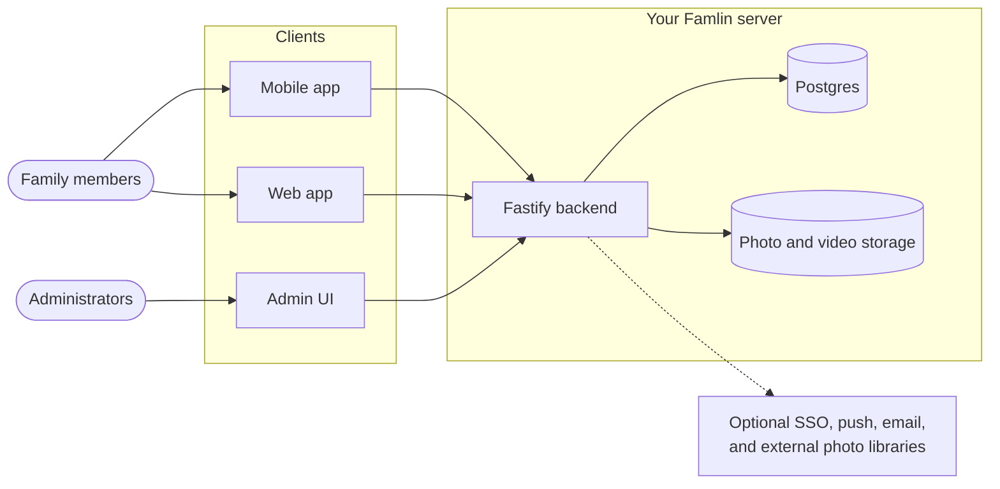

# Architecture

This is the high-level map of Famlin. See [Backend reference](./backend-reference.md) for implementation details and the [API reference](./api-reference/famlin-api) for exact endpoint schemas.

## Repository layout

| Path | Purpose |
| --- | --- |
| `backend/` | Fastify, TypeScript, Prisma, and Postgres API |
| `backend/admin/` | React + Vite admin UI, served at `/admin` |
| `web/` | Member-facing React + Vite app, served at `/` |
| `mobile/` | Expo / React Native app for iOS and Android |
| `packages/api-client/` | Shared API, domain types, and React Query helpers |
| `packages/design-tokens/` | Platform-independent design values and generated CSS |
| `packages/ui/` | Shared browser primitives used by the admin UI |
| `deploy/` | Packaging for third-party app stores |
| `docs/` | This Docusaurus documentation site |
| `website/` | Static marketing site at `famlin.app` |

The root `docker-compose.yml` defines the production stack. `docker-compose.override.yml` adds local hot-reload development settings.

## System overview

A deployment serves the API, member web app, and admin UI from one backend container, with Postgres alongside it. Photos and videos use local storage by default or an S3-compatible service. External identity, notification, and media providers are optional.

## Request lifecycle

1. A client calls the Fastify API using a session token, personal API token, or media token where appropriate.
2. The backend authenticates the caller and applies family and circle visibility rules.
3. Routes validate input and delegate domain work to services.
4. Prisma reads or writes Postgres; media services handle uploaded or linked photos and videos.
5. Committed changes emit domain events. Subscribers handle notifications and other side effects without making the request depend on them.

Background jobs handle backups, expired stories, memories, linked-album changes, and system checks.

## Backend structure

| Location | Responsibility |
| --- | --- |
| `backend/src/routes/` | HTTP endpoints, validation, and authorization |
| `backend/src/services/` | Domain logic and integrations |
| `backend/src/plugins/` | Fastify authentication and request plumbing |
| `backend/src/events.ts` | Typed in-process domain events |
| `backend/src/subscribers/` | Notification and other event reactions |
| `backend/src/jobs/` | Scheduled background work |
| `backend/prisma/` | Schema, migrations, and development seed data |

Member-facing list endpoints use cursor pagination. Posts, comments, and users are hard-deleted rather than soft-deleted.

## Core design rules

- **Family membership is the main authorization boundary.** Every member-facing content query is scoped to the caller's families.
- **Circles only narrow access.** They cannot grant access to someone outside the family. Member-facing queries must use the shared visibility helpers so private content is not exposed accidentally.
- **Uploads are authorized per request.** An unguessable media URL is not treated as permission to read it.
- **Configuration is split by lifetime.** Startup environment variables configure the process and storage; most runtime settings live in the database and are managed in `/admin`.
- **Public origins come from the request.** Behind a reverse proxy, forwarded headers are trusted only when `TRUST_PROXY=true`.
- **Interface text is translated.** Apps and server-rendered messages use locale keys rather than hardcoded user-facing strings.

The user-facing implications are covered in [Security](/security).

## Data model at a glance

The main model groups are:

- **Identity and audiences:** `User`, `Group`, `GroupMember`, `Circle`, and `CircleMember`
- **Family content:** `Post`, `Comment`, `Like`, `Favorite`, `Story`, `ChatMessage`, `WikiPage`, and gift-list models
- **Media:** `Upload`, `MediaAlbumLink`, and `MediaPersonLink`
- **Runtime state:** `Setting`, `Notification`, `PushToken`, `ApiToken`, `Device`, `DiagnosticReport` (scroll performance reports members chose to send to their admins, pruned after 30 days — see [Mobile scroll diagnostics](./mobile-performance.md)), and backup/job status models

A post belongs to one family and can optionally belong to one circle. Its open `type` plus handler-owned `typeData` supports updates, milestones, polls, events, trips, albums, and gift lists. Cross-posting creates linked sibling posts in multiple families while preserving each family's access boundary.

See [`backend/prisma/schema.prisma`](https://github.com/TimVanOnckelen/famlin/blob/main/backend/prisma/schema.prisma) for fields and relations, and [Backend reference](./backend-reference.md#data-model) for the design rationale.

## Extension points

| Extension | Location | Examples |
| --- | --- | --- |
| Post type handlers | `backend/src/services/postTypes/` | Polls, events, trips, albums, gift lists |
| Media providers | `backend/src/services/media/` | Immich and local photo libraries |
| Notification channels | `backend/src/services/notificationChannels/` | Push and email |

Registries make these capabilities explicit. Persisted post-type and provider ids must remain stable because existing installations store them.

## Clients and shared code

Mobile and web use `@famlin/api-client` for API calls and domain types. Each platform supplies its own token-storage adapter. The admin UI additionally uses `@famlin/ui` and `@famlin/design-tokens`; see [Shared UI](./shared-ui.md).

The backend serves the production web and admin builds. During development, each frontend can run through Vite or Expo against the same API.

## Further reading

- [Backend reference](./backend-reference.md) — routes, models, uploads, authentication, and background services
- [Using the API](./api.md) — authentication, pagination, errors, and examples
- [API reference](./api-reference/famlin-api) — generated endpoint and schema documentation
- [Quick start](./quick-start.md) — run the stack locally
- [Contributing](./contributing.md) — development and pull-request conventions
