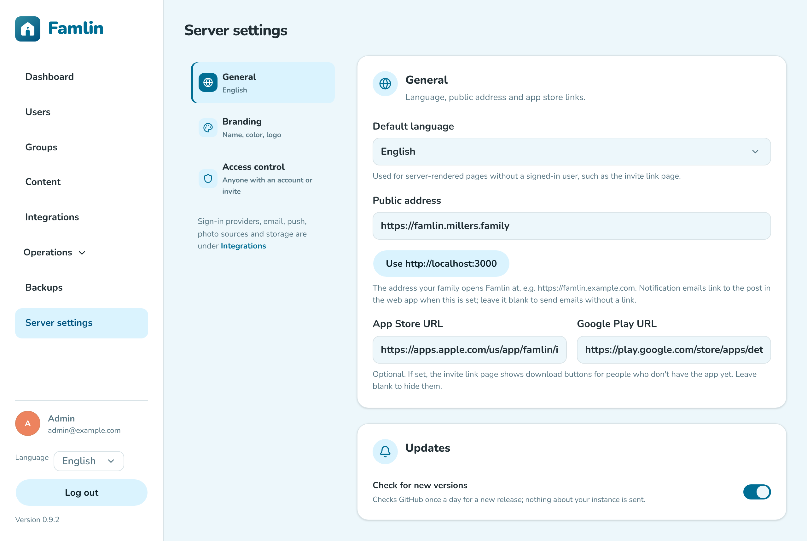
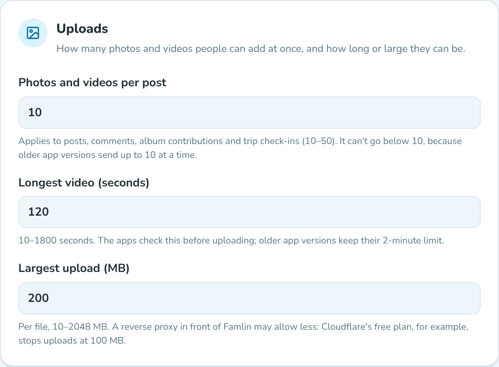
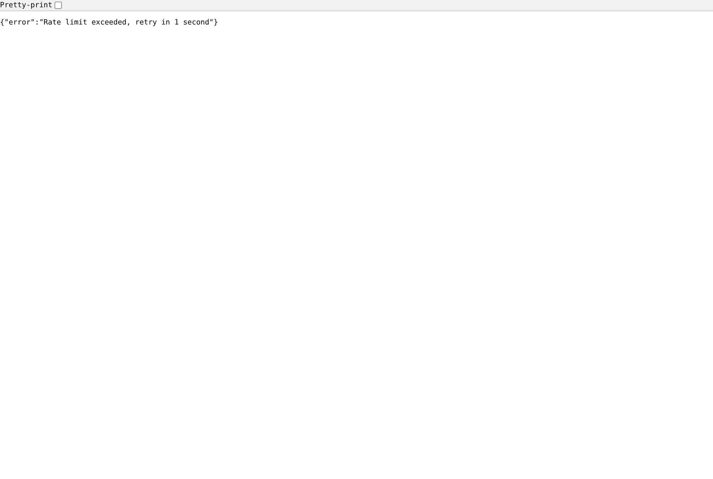
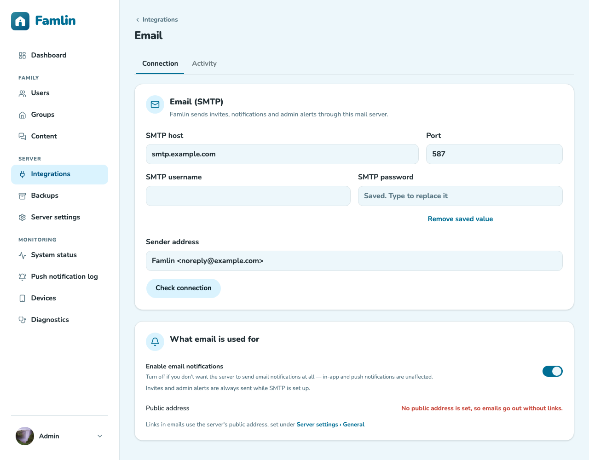
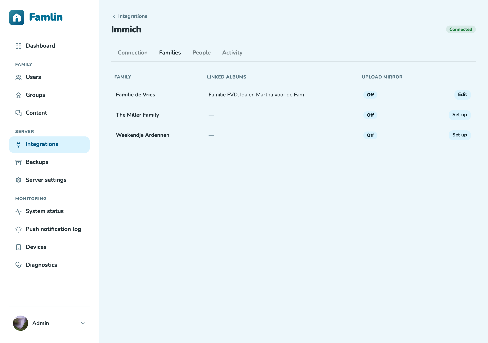
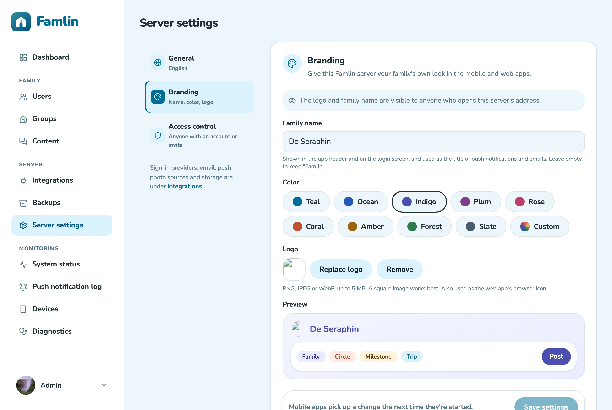
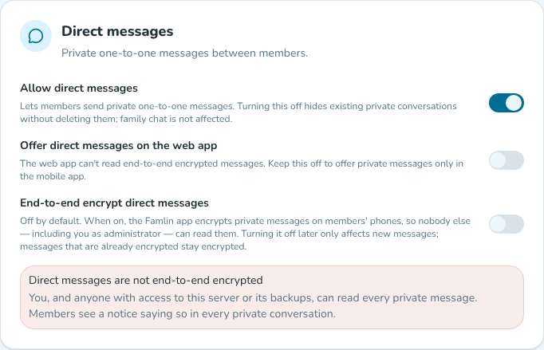

# Admin configuration

Once the containers from [Server setup](./server-setup.md) are up and reachable, finish setup from the admin UI at `/admin`.

## First login

Only administrators can sign in to `/admin`, using either a password or SSO.
Signing in with a regular account shows an error on the login form so you can
try again with an administrator account. Previously saved non-admin sessions
are cleared automatically when the admin UI loads.

Open `https://famlin.yourdomain.com/admin`. On a fresh install (no users in the database yet) it shows a **one-time setup screen** instead of the login form — fill in your name, email, and a password to create the first account, which is automatically made an admin. There is no default or seeded account; if the setup screen doesn't appear, an admin account already exists and you should log in with it instead (an existing admin can reset another admin's password from the Users page; if every admin's password and access is lost, the only recovery path is connecting to the `famlin-db` container directly and clearing the affected row).

After that, two admin pages hold the configuration:

- **Server settings** has three sections, listed on the left: **General**, **Branding** and **Access control**. Changes are saved with the save bar that appears at the bottom; Branding has its own save button.
- **Integrations** holds every connection to another service: sign-in providers, email, push notifications, photo sources and media storage. See [Integrations](#integrations) below.

Backups (the schedule, the data export and restoring) have their own **Backups** page in the admin menu.

- **Default language** (General): used for server-rendered pages that don't have a signed-in user yet (the invite link landing page, `/invite/:token`) and for the text of push notifications and emails. Choose English, Nederlands, 简体中文 (Simplified Chinese) , Português (Portugal) (European Portuguese) Français (French) or Español (Spanish). Defaults to English.
- **Public address** (General): the address your family opens Famlin at, for example `https://famlin.example.com` — just the scheme, host and (if it isn't 80/443) port, no path. When set, notification emails end with a link to the post in the web app (trips, albums and gift lists open their own page; new photos in a linked album open **Photos**). Someone who isn't signed in logs in first and then lands on that post, and the link still only works for people who are allowed to see it. Empty by default, in which case emails are sent without a link exactly as before. The **Use …** button fills in the address you're using the admin panel from; change it if that's an internal address (such as `http://192.168.1.10:3000`) your family can't reach from outside. Famlin needs this because emails are sent in the background, where there's no browser request to read the address from. **Sign in with Apple** also checks it: the iPhone app signs in for the address it uses, and Famlin only accepts that sign-in when it matches this address — or, while this is empty, the address the request reached the server as. Set it if Apple sign-in fails with a server-log warning about a different host, which happens when a reverse proxy rewrites the address. Members' [calendar subscriptions](./calendar-subscription.md) use it too: their links are built on this address, and each calendar entry links to its event only when it is set.
- **App Store / Google Play URLs** (General): optional. If set, the invite link page shows download buttons for people who don't have the app yet; leave blank to hide them. Both default to the official pre-built apps ([App Store](https://apps.apple.com/us/app/famlin/id6786783660) and [Google Play](https://play.google.com/store/apps/details?id=be.xeweb.famlin)), so a fresh deployment already has working download links. Override either one if you build and distribute your own app instead, or clear it to hide that button.
- **Uploads** (General): how much your family can attach and upload. All three apply to every family on the server.

  

  - **Photos and videos per post**: the most attachments on one post, comment, check-in on a [trip](./trips.md), or batch of photos added to a [shared album](./photos-and-albums.mdx). Default 10, between 10 and 50. It can't go below 10 because app versions installed before this setting existed always allow 10. Those older versions keep offering at most 10 even after you raise it; updated apps and the web app follow your setting. Raise it if your family often shares bigger batches, for example after holidays. Before this setting, posts made in the web app or through the API could hold up to 20 attachments; they now hold 10 by default, so raise it if your family relied on that. Lowering the setting never locks an existing post or comment: it can still be edited as long as the edit doesn't add attachments beyond what it already has.
  - **Longest video (seconds)**: the longest video members can attach. Default 2 minutes (120 seconds), between 10 seconds and 30 minutes. The apps and web app check it when a video is picked, before uploading; the server doesn't, and app versions installed before this setting keep the 2-minute limit. Longer videos are also bigger files, so raise **Largest upload (MB)** with it.
  - **Largest upload (MB)**: the largest single file the server accepts, in MB. Default 200 MB, between 10 and 2048 MB. The server enforces it for every upload. Long or high-resolution videos reach it first. A reverse proxy in front of Famlin can reject large uploads before they reach the server, whatever you set here: Cloudflare's free plan, including [Cloudflare Tunnel](./cloudflare-tunnel.md), stops at 100 MB per request, and Nginx allows only 1 MB unless you raise `client_max_body_size` (see [your own reverse proxy](./server-setup.md#option-c-your-own-reverse-proxy)). Raising this also needs more temporary disk space while an upload is processed (see [Storage](./storage.md)).
- **Check for new versions** (General → Updates): on by default. Once a day the server checks GitHub for a new Famlin release and shows an "update available" banner in the admin UI; nothing about your instance is sent. Turn it off to stop the check and hide the banner. See [Staying up to date](./maintenance.md#staying-up-to-date).
- **Branding**: family name, color and logo. See [Branding](#branding) below.
- **Allowed email addresses** (Access control): restrict which emails may create an account. Leave empty to allow anyone who reaches the login page.
- **Backups** are on their own admin page: see [Backups](./managing-users-and-content.md#backups).

All of this is stored in the database, so it survives redeploys of the backend image without any env var changes. (Storage is the exception: see [Storage](./storage.md).)

## Integrations

`/admin` → **Integrations** lists every service Famlin connects to, grouped by what it does: **Photos** (Immich, Local folders), **Sign-in** (Single sign-on, Sign in with Apple), **Messages** (Email, Push notifications) and **Storage** (Media storage).

Each card shows one status:

- **Connected**: set up, the last connection check passed, and the background jobs that use it succeeded.
- **Needs attention**: it works, but something needs a look, such as an upload that couldn't be mirrored, a failed background job, or email without a [public address](#first-login) for its links.
- **Failing**: the connection check fails (wrong address or password, server down), or media storage fell back to its fallback location.
- **Not set up**: nothing to check yet. An integration that isn't set up never shows warnings.

Connection checks contact other servers, so the page shows the result of the last check and its time. **Check now** runs them again; saving an integration's settings also refreshes its status.

Open a card to configure it. Every integration page has the same tabs:

- **Connection**: the address, keys and switches, with a test button. Saved passwords and keys are never shown again (see [Saved secrets](#saved-secrets)). Save with the save bar at the bottom.
- **Families** (Immich, Local folders): every family and the albums it can pick photos from, plus, for Immich, where its uploads are mirrored. **Edit** on a row opens that family's album and mirror settings.
- **People** (Immich): [mapping recognized people](#mapping-people-in-albums).
- **Activity**: the background jobs that use the integration, and for push the delivery numbers.

What each integration covers:

- **Single sign-on**: see [OIDC / SSO login](#oidc--sso-login) below. Optional; email/password login always works.
- **Sign in with Apple**: works without setup; see [Sign in with Apple](#sign-in-with-apple).
- **Email**: the SMTP **host**, **port**, **username**, **password** and **sender address**, and **Enable email notifications** to turn notification emails on or off for the whole server. Invites and [system alert emails](./managing-users-and-content.md#system-status) to admins are sent whenever SMTP is set up, even with email notifications off. **Check connection** tests the saved settings, so save first. Famlin sends notification emails over at most three SMTP connections at a time, which stays within the connection limits of common mail providers (Gmail, Fastmail, Amazon SES and others) even in large families.
- **Push notifications**: turn push notifications on or off for the whole server. Members choose per event type in their own profile. The Activity tab shows delivered and failed sends and links to the [push notification log](./managing-users-and-content.md#push-notification-log).
- **Immich** and **Local folders**: see [Media integrations](#media-integrations) below.
- **Media storage**: where uploaded photos and videos are stored (a Docker volume, a NAS folder or an S3 bucket). It's configured with environment variables, not here; see [Storage](./storage.md). The page shows the storage location and any migration in progress.

## OIDC / SSO login

Famlin supports login via any standards-compliant OpenID Connect provider (Google, Microsoft Entra ID, Authentik, Keycloak, Auth0, ...) alongside email/password, configured entirely from `/admin` — no rebuild or client-side env vars required.

Setup differs slightly depending on whether your provider supports a secretless public/native client:

### Self-hosted providers (Authentik, Keycloak, Auth0, ...)

1. Register Famlin as a **public/native client** (no client secret), with **PKCE** enabled.
2. Add redirect URIs:
   - Mobile app: `famlin://` (the app's URL scheme; see `mobile/app.config.js`)
   - Web app: `https://famlin.yourdomain.com/`
   - Admin UI: `https://famlin.yourdomain.com/admin/`
3. In `/admin` → Integrations → **Single sign-on**, fill in **Issuer URL**, **Client ID**, **Scopes** (defaults to `openid email profile`), and **Display name** (shown on the login button). Leave **Client secret** blank.

Famlin links an SSO login to an existing account by email, so it refuses any login whose ID token marks the email as unverified (`email_verified: false`). Keep email verification enabled at your provider if it allows self-registration or user-editable email addresses; providers that don't send the claim at all (such as Microsoft Entra ID) keep working.

### Google

Google's OAuth clients always require a client secret for the token exchange, and its native "iOS"/"Android" client types force the mobile redirect onto a Google-generated scheme Famlin's shared, pre-built Android app can't have baked in ahead of time (every self-hosted deployment registers its own separate Google client). So instead, register one ordinary **Web application** client:

1. In [Google Cloud Console](https://console.cloud.google.com/auth/clients) → **Create OAuth client** → **Web application**.
2. Add three **Authorized redirect URIs**:
   - `https://famlin.yourdomain.com/` (web app)
   - `https://famlin.yourdomain.com/admin/` (admin UI)
   - `https://famlin.yourdomain.com/api/auth/oidc/mobile-callback` (mobile app)
3. Copy the **Client ID** and **Client secret** Google generates.
4. In `/admin` → Integrations → **Single sign-on**, fill in:
   - **Issuer URL**: `https://accounts.google.com`
   - **Client ID** and **Client secret** (Google is the main reason this field exists — most other providers don't need it)
   - **Scopes**: `openid email profile`
   - **Display name**: e.g. `Google`

Setting a **Client secret** makes Famlin do the authorization code exchange on the backend instead of in the browser/app, which is what lets a normal Web application client work for the web app, the admin UI, and the mobile app — see [Backend reference: OIDC / client-secret providers](/docs/developers/backend-reference#oidc--client-secret-providers) for how that works under the hood.

### Sign in with Apple

Nothing to configure. The mobile app offers **Sign in with Apple** on iOS in addition to whatever else you've enabled, and the server verifies Apple's identity tokens directly against Apple's published keys — there's no client ID, secret, or issuer to fill in, and it works the same on every self-hosted deployment.

It follows the same access rules as any other login: an account is only created for a new person if their email is on the allow-list (see below), or if they came in through a valid invite link. Note that Apple lets people hide their real address behind a `@privaterelay.appleid.com` relay address, which you can't put on an allow-list ahead of time — so in practice family members using Sign in with Apple should join through an invite link.

The one setting that exists, **Extra Apple bundle IDs** (`/admin` → Integrations → **Sign in with Apple**), is only for self-hosters who build and distribute their *own* iOS app instead of installing the official one: put your build's bundle identifier there (comma-separated for several) so this server accepts sign-ins issued to it. The official app's bundle ID is always accepted, so leave the field empty otherwise.

### Access control

Optionally restrict sign-ups with **Allowed email addresses** (`/admin` → Server settings → **Access control**). New accounts are only auto-provisioned via OIDC or Sign in with Apple if the email is allowed (empty allow-list = allow all). An unlisted email will be rejected even with a valid login — unless it arrives through a valid invite link, which is its own authorization and deliberately bypasses the allow-list.

## Saved secrets

Four settings are credentials for other systems: the OIDC **Client secret**, the **SMTP password**, the Immich **API key** and the optional Immich **Upload key**. Famlin stores them but never shows them again, not in the admin UI and not through the API. A stolen admin session therefore does not also hand over your mail account, your sign-in provider or your photo library.

- A saved secret shows as **Saved. Type to replace it**. Leave the field empty to keep it.
- **Remove saved value** deletes it when you save.
- Changing the address a secret belongs to (the OIDC issuer URL, the SMTP host or the Immich server URL) removes the saved secret unless you enter it again in the same save. Otherwise someone with admin access could point Famlin at a server of their own and collect the secret there.
- **Test connection** and **Test upload key** for Immich use the saved key only against the saved server URL. To test a different address, type the key.

## Media integrations

Famlin can let members pick photos from external sources when composing a post, without copying anything into Famlin's own storage. Famlin only reads these sources (the one exception is the opt-in [Immich upload mirror](#mirroring-uploads-to-immich)), and they're not where Famlin keeps the photos members upload (that's [Storage](./storage.md)). Each source is configured once for the whole server (`/admin` → Integrations → **Immich** or **Local folders** → **Connection**); which albums each family can see is then set on that integration's **Families** tab. A family can have multiple linked albums across different sources.

### Immich

If your family already runs [Immich](https://immich.app) for photo storage:

**Recommended setup:** Create a dedicated Famlin user in Immich, then have family members share their albums with that user. This way, Famlin can list all relevant albums in one place without you manually linking each one.

1. In Immich (as an admin), create a user account for Famlin (e.g. `famlin@home.local`).
2. Have each family member share their albums with this Famlin user (in Immich, right-click an album → Share → add the Famlin user).
3. Create an API key for the Famlin account (log in as the Famlin user, Account settings → API Keys). A key scoped to just `album.read`, `asset.read`, `asset.view`, and `asset.download` is enough — Famlin only reads with this key. (The optional [upload mirror](#mirroring-uploads-to-immich) uses a second key.)
4. In `/admin` → Integrations → **Immich** → **Connection**, enter your Immich server URL (e.g. `https://immich.example.com`) and the API key, then click **Test connection** to confirm Famlin can reach it.
5. Save settings.
6. Open the **Families** tab and click **Set up** (or **Edit**) on a family: under **Linked albums** the dropdown now shows both the Famlin account's own albums and any shared with it. Pick the ones you want this group to see.

Members never see an Immich login, token, or API key — the underlying image is streamed live from your Immich server through Famlin's own authenticated proxy.

**Videos:** Famlin plays the browser-friendly version of a video that Immich has already made (H.264/AAC mp4), not the original file. A 4K HEVC clip from an iPhone therefore plays in every browser and on every phone, and uses far less data. Keep video transcoding enabled in Immich (Administration → Settings → Video Transcoding) and make sure the API key has the `asset.view` permission. If Immich has no converted version, or the key may not use it, Famlin streams the original file as before.

### Mirroring uploads to Immich

Photos and videos that members post directly in Famlin normally live only in Famlin. If your family uses Immich as its photo archive, you can have Famlin **copy** them into an Immich album, one album per family. This is off by default and changes nothing until you turn it on for a family.

It is a mirror, not a storage location. Famlin keeps its own files and keeps deciding who may see them. Deleting something in Immich never affects Famlin.

**What gets mirrored:** the original photos and videos (full quality, not the resized copy Famlin shows) of posts shared with the **whole family**, including photos added to shared albums and trip check-ins. A Live Photo is uploaded with its video. Immich reads the capture date from the file, so photos land at the right place on its timeline.

**What is never mirrored:** media in [Family Circle](./managing-users-and-content.md) posts, gift lists and stories. A photo used in a circle post as well as a family-wide post stays out too. Also skipped: photos attached to ordinary comments, chat photos, wiki images, and photos that came from a linked album in the first place.

**Setting it up:**

1. In Immich, create a second API key for the Famlin user with these permissions: `asset.upload`, `asset.read`, `album.create`, `album.read`, `albumAsset.create`, `albumAsset.delete` and `person.read`. Keep the first key read-only. (`person.read` lets Famlin read Immich's face recognition on mirrored photos, see [faces on uploaded photos](#faces-on-uploaded-photos); without it mirroring still works, just without face tags.)
2. In `/admin` → Integrations → **Immich** → **Connection**, paste it into **Upload key (optional)** and click **Test upload key**. The test lists any permission the key is missing. Save settings.
3. Open the **Families** tab, click **Edit** on the family, and find **Mirror uploads to Immich**. Choose **Create a new album "Famlin – &lt;family name&gt;"** or an existing album. Optionally pick a **Mirror posts since** date to also copy older posts (empty = from now on). Click **Turn on mirroring** and confirm.

A background job runs every 10 minutes. The Families tab shows each family's mirror album and how many uploads are mirrored or failed; **Edit** shows the last error of each failed upload. **Sync now** starts a run straight away and retries failed uploads. A post is never held up by Immich: if Immich is down, the job fails, shows up on the Immich **Activity** tab (and under System status → Background jobs), and catches up on its next run.

**When a post is deleted or a photo is edited out**, Famlin removes it from the album. It never deletes the photo from Immich itself, and it only removes photos it added. If the album already held the same photo (because a phone backup put it there, say), Famlin leaves it alone.

**Pause** stops adding new photos. Famlin still takes photos of deleted posts back out of the album while paused. **Resume** picks up where it stopped. If a family is switched to another album (through the admin API), Famlin takes the photos it added out of the old album.

Removing a photo from the album never deletes it from Immich: it stays in the library of the Immich user the upload key belongs to. A mirrored photo that someone removes from the album by hand in Immich is added back on the next sync while its post exists.

An album that is linked to a **different** family under **Linked albums** can't be chosen as a mirror album, and another family's mirror album can't be linked: either way, one family's photos would show up in the other's Photos tab. Two families can share one mirror album; a photo posted to both is uploaded once.

:::warning Who can see the album is decided in Immich
Anyone the Immich album is shared with sees every mirrored photo, whether or not they are in the family in Famlin. Someone removed from the family keeps access to what was already mirrored until you change the album's sharing in Immich. Famlin does not manage Immich sharing.
:::

If you also link the mirror album to the same family as a linked album, Famlin recognizes its own mirrored photos: they don't show up twice in the Photos tab, and [new asset detection](#new-asset-detection) doesn't turn them into new posts.

### Local folders

Serve photos straight from a directory on the server — handy when your photos already live on the NAS Famlin runs on and are synced there by another tool (Syncthing, rsync, a phone upload app).

1. Make the directory visible inside the Famlin container: add a bind mount to the `famlin-backend` service in your `docker-compose.yml`, e.g. `- /volume1/photos/famlin:/media/photos:ro` (read-only is enough — Famlin never writes to it).
2. In `/admin` → Integrations → **Local folders** → **Connection**, enter the *container-side* path (e.g. `/media/photos`) and click **Check path**.
3. Save settings.
4. Every immediate subdirectory of that path is now a linkable album: open the **Families** tab, click **Set up** (or **Edit**) on a family, and pick a folder under **Linked albums**.

Only image files (`jpg`, `jpeg`, `png`, `gif`, `webp`, `avif`) directly inside the folder are listed — subfolders of an album and video files are ignored for now. Thumbnails are generated on the fly and cached inside the container.

### New asset detection

Each linked album can be configured to surface newly-added assets to your family automatically:

- **OFF** (default) — never notify about new assets. The album appears in Famlin but doesn't send alerts or create posts.
- **MANUAL** — send a notification when new assets appear. Members get a notification (as if a new post arrived) but Famlin doesn't auto-create a post — good for albums you want to stay aware of without flooding the feed.
- **AUTO** — automatically create a post in the group with new assets. An hourly job checks linked albums; when it finds new photos/videos, it creates a real post (authored by an admin, preferring a group-member admin if one exists) that flows through Famlin's normal post pipeline with notifications — good for auto-import workflows (e.g., a Synology camera folder that fills hourly, a cloud-synced photo album).

To set this, open the integration's **Families** tab, click **Edit** on the family, and choose a mode next to the album.

The hourly job runs at minute 15 of every hour (check the server logs to confirm it's running). On the first run for an album, it only initializes the watermark — it doesn't retroactively notify about pre-existing assets, only new ones added after that point.

### Mapping people in albums

For Immich albums with face recognition data, you can map recognized people to display names and optionally link them to Famlin users. This lets members filter album views by person when composing a post (e.g., "show me photos of Alice") and keeps face data private — only admin-mapped people are visible to family.

1. Go to `/admin` → Integrations → **Immich** → **People**. The recognized people come from Immich's face recognition.
2. Under **Unmapped people**, search or browse the grid of recognized faces and click a person. The catalog includes people detected across your linked albums, including those in albums shared by other Immich users — these may not have thumbnails available if they're only recognized in shared albums you don't directly own.
3. Fill in the **Display name** (a human-readable name shown to family, e.g. "Alice" or "Grandpa") and optionally a **Family member** (pick a Famlin user if this person is someone in the family; leave blank otherwise), then click **Save**. Mapped people now appear in member UI when they're picking photos for a post, scoped to each group's linked albums.

**Merging people with the same label:** When you map two provider-side persons (e.g., the same child recognized separately in two parents' Immich libraries) to the same display name, Famlin treats them as one person for your family. The people picker shows a single entry, photo filters match all photos tagged with that label, and posts show one chip instead of duplicates. This is handy when the same person appears in multiple photo sources — just give them the same label and they merge automatically. The admin UI's **Display name** input suggests existing labels to make this easy; reusing a label is how merging happens.

Mapped people also appear as tags on posts in the family feed, showing who's in each photo — when a person is linked to a Famlin user, their profile avatar appears on the tag.

To remove a mapping, click the × next to it under **Mapped people**.

#### Faces on uploaded photos

Photos members upload straight into Famlin have no face data of their own. Once the [upload mirror](#mirroring-uploads-to-immich) has copied them into a family's Immich album, Immich runs its face recognition on them like on any other photo, and Famlin reads the result back with the upload key. Mapped people then show up on those posts too: as tags in the feed (including photos added to shared albums and trip check-ins), and in the **Photos** tab's person filter.

- There's nothing extra to turn on: it works for every family with mirroring on, as long as the upload key has the `person.read` permission. **Test upload key** lists it when it's missing.
- People recognized in the mirror albums appear in the **People** tab's catalog, so you can map them like everyone else. If the upload key belongs to a different Immich user than the read key, Immich keeps separate face entries for each user: map both under the same display name and Famlin merges them.
- Immich needs a few minutes after an upload to detect faces, and Famlin refreshes what it knows about each album every 10 minutes, so new tags can take a while to appear.
- Only photos that are actually mirrored get tags. Circle posts, gift lists and stories are never mirrored, so they never get face tags this way. Photos posted before the family's **Mirror posts since** date only get them if you backfill.

## Branding

You can give your Famlin server your family's own look: a **family name** ("The Janssens"), a **color**, and a **logo**. It's set once for the whole server, in `/admin` → Server settings → **Branding**, and applies in the mobile app and the web app. With nothing set, Famlin looks exactly as it always has.

- **Family name** (up to 40 characters) appears in the app header and on the login screen, and becomes the title of push notifications and the subject of notification emails ("New activity in The Janssens"). Leave it empty to keep "Famlin".
- **Color** — pick one of the curated presets, or choose **Custom** and enter any hex color. The live preview shows the result:
  - If your color is too light for white text to stay readable on buttons, Famlin automatically darkens it until it meets the WCAG AA contrast ratio (4.5:1), and the settings page tells you which color it will actually use. Your original choice is what's saved, so you can always come back to it.
  - Circle, milestone and trip posts each have their own color (coral, gold and blue). If your brand color is close to one of them, that post color automatically moves to a different hue, so a circle post can never be mistaken for a normal family post. The preview lists which ones changed.
- **Logo** — PNG, JPEG or WebP, up to 5 MB (SVG isn't accepted). Famlin re-encodes it, resizes it to at most 512 px, and also uses it as the web app's browser icon. A square image works best.

The login screen gets a soft gradient background derived from your color. It deliberately never shows a photo: everything before login is visible to anyone.

:::caution[Public by design]
The logo and family name are visible to anyone who opens your server's address — the login page has to show them before anyone has signed in. Don't put anything in them you wouldn't put on a doorbell.
:::

**When it shows up:** the web app picks up a change on the next page load. The mobile app applies the brand right after someone connects to your server, and picks up a later change the next time the app is started from scratch — it never changes colors while someone is using it. The app icon and store name can't change; they belong to the shared Famlin app. Mobile branding needs an app version with branding support; older installed apps keep the default look, but the push-notification title uses the family name on every version.

The invite page that invite links open also shows the family name, logo and colors. Branding is included in the [data export](./managing-users-and-content.md) and comes back with a restore.

## Direct messages

Members can send each other private one-to-one messages. Three settings in `/admin` → Server settings → **General** → **Direct messages** control them.

- **Allow direct messages** (default: on). Lets members send private one-to-one messages. Turning it off hides existing private conversations without deleting them, and every private-message action is refused until you turn it back on; the data is kept. Family chat is not affected. Turn it off if your family only wants the shared group chat.
- **Offer direct messages on the web app** (default: off). The web app can't read end-to-end encrypted messages, so by default only the mobile app offers private messages. Turn it on if you want the web app to offer them too (those web messages are then not encrypted). This is a hint the apps follow, not access control: the server can't tell its clients apart, so it doesn't block anything itself.
- **End-to-end encrypt direct messages** (default: off). When on, the mobile app encrypts private messages on members' phones so nobody else, including you as administrator, can read them. Turning it on asks you to confirm, because it is a trade-off either way (see below). Turning it off again only affects new messages: messages that are already encrypted stay encrypted and readable by their participants.

:::danger Both choices carry a risk

- **Encryption off (the default):** private messages are stored readable on the server. You, and anyone who can get at the server, its database or its backups, can read every direct message. Members see a notice saying so in every private conversation.
- **Encryption on:** only members' phones hold the keys. If a member loses their phone without a keychain backup (iCloud Keychain or Google backup) or a recovery code, their encrypted messages **cannot be recovered** — not by you, and not from a server backup or restore. You also can't read or moderate encrypted messages.

The settings page shows the risk of the current choice under the switch.

:::

The last two switches are greyed out while direct messages are off. Admin content moderation never shows private messages, and the [data export](./managing-users-and-content.md) is unchanged by these settings. They are saved in backups and come back with a restore.

## Next steps

Once your admin account and login method are set up, [invite family members](./inviting-family.md) to start using Famlin.
