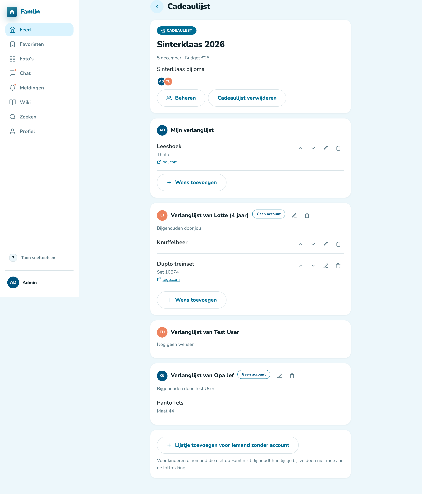

# Gift lists and Secret Santa

A **gift list** collects everyone's wishes for an occasion — Christmas, Sinterklaas, a birthday — and can optionally draw Secret Santa names, so every participant buys for exactly one other person. It works the same in the web app and the mobile app.

## Starting a gift list

1. Create a new post and choose **Gift list**.
2. Give it a title ("Christmas 2026", "Grandma's 80th") and, optionally, the date of the occasion.
3. Pick the participants from the family you're posting in. You're always one of them.
4. Optionally turn on the **Secret Santa draw**, set a suggested budget, and add **exclusions** — pairs who shouldn't draw each other, such as partners.

A gift list belongs to one family and can't be shared with several families at once.

In the web composer, open **What do you want to share?** to choose a format. Each option shows
an icon, a name and a short description; only formats allowed by the selected
family are offered. Use the **Secret Santa draw** switch to enable or disable
the draw. The type picker also supports arrow keys, Enter to select and Escape
to close without leaving the composer.

## Who can see it

Only the participants. Other family members don't see the gift list anywhere — not in the feed, search, photos, favorites or notifications — and photos attached to wishes are private to the participants too. Admins who aren't participants can't read it either; it is only included in the admin's full server backup.

## Wishlists

Every participant keeps their own wishlist inside the gift list. A wish has a title and, optionally, a note (size, color…), a link to a web shop and a photo. You can add, edit, reorder and delete your own wishes at any time, and you can see everyone else's list.

There's deliberately no way to mark a wish as "taken" or "bought" — the draw is what keeps people from buying the same thing.

## Wishlists for people without an account

Not everyone has a Famlin account — young children, or a grandparent without a smartphone. Any participant can add a wishlist for them with **Add a wishlist for someone without an account** at the bottom of the gift list, and give it a name ("Lotte", "Grandpa Jef").

- The participant who adds it **keeps it up**: only they can add, edit and reorder its wishes. It's shown right below their own wishlist, marked **No account**.
- Every participant can see it, just like any other wishlist.
- They (or the person who started the gift list) can rename or remove it. Removing it deletes its wishes.
- People without an account **don't take part in the Secret Santa draw** — nobody draws them and they don't draw anyone. Their wishlist is there for anyone who wants to bring them something.
- If the participant who keeps it up leaves the gift list (or the family), the wishlist goes with them.

A gift list can hold up to 30 such wishlists. This needs a server that supports it; older mobile app versions simply don't show these wishlists.

## The Secret Santa draw

Once everyone is in (at least 3 participants), the person who started the gift list draws the names. Everyone then sees **only who they are buying for**, with a shortcut to that person's wishlist. Nobody can see the other pairings — not the starter, and not an admin.

If the exclusions make a draw impossible (for example, someone is excluded with everybody else), you'll get a message asking you to remove some of them.

The notification that the names are drawn never mentions who you got, since notifications can show up on a locked phone screen.

## Changing things afterwards

- **Adding or removing participants** after the draw asks the starter for confirmation, then draws all names again from scratch. Everyone is notified.
- **Leaving:** any participant except the starter can leave a gift list. Their wishlist is removed and, if the names were drawn, they're drawn again.
- **Deleting:** the starter deletes the gift list like any other post.
- If someone leaves the family or deletes their account, their wishes disappear and an active draw is redone automatically. Gift lists they started are deleted, since they can't be handed over.

## Notifications

You get a push notification when you're added to a gift list, when the names are drawn (or redrawn), and — once the draw is done — when the person you're buying for adds a wish (several wishes on the same day are bundled). You can turn these off under **Gift lists** in your profile's notification settings.

## "My gift lists"

Your profile page has a **My gift lists** overview with every gift list you take part in, across all your families, newest occasion first.
