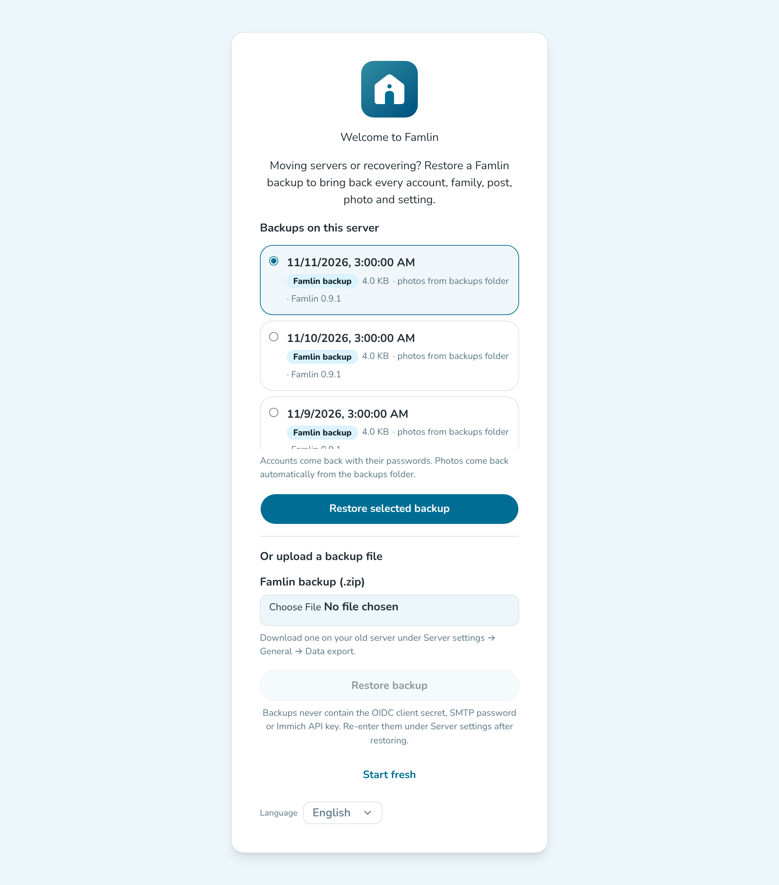

# Maintenance

## Backups

Two things need backing up:

- **`famlin-db-data`** (Docker volume) — the Postgres database: users, groups, posts, comments, settings.
- **`famlin-uploads`** (Docker volume) — uploaded photos and videos. If you store media in S3 instead, see [Backups and exports with S3](./storage.md#backups-and-exports-with-s3).

Famlin can do this for you on a schedule (see [Scheduled backups](#scheduled-backups) below), or you can include the volumes in a backup routine you already have.

Both are named volumes declared in `docker-compose.yml`. Find their host paths with:

```bash
docker volume inspect famlin_famlin-db-data famlin_famlin-uploads
```

(the `famlin_` prefix is the Compose project name, usually derived from the directory the compose file lives in). Include both paths in your existing backup routine — on a Synology NAS this typically means pointing Hyper Backup or a scheduled `rsync` task at the Docker data folder that contains them.

A simple logical backup of just the database can also be taken with `pg_dump`:

```bash
docker compose exec famlin-db pg_dump -U famlin famlin > famlin-backup.sql
```

### Scheduled backups

Famlin can back itself up on a schedule. It's **on by default for new installs** (daily at 03:00, keeping 7 backups; the first-run setup, including a restore, turns it on). Servers that were set up before this default existed keep their existing choice, which is off unless you enabled it. Change or turn it off under **Server settings → Backups** in `/admin`:

- **Schedule**: daily, or weekly on Sundays.
- **Time**: the hour it runs, in the server's time zone. The suggested default is 03:00.
- **Backups to keep**: how many backups to keep (default 7). Older ones are deleted after each run.

Each run writes to the `famlin-backups` volume, mounted at `/app/backups` in the container:

- `famlin-backup-<timestamp>.zip`: a **Famlin backup** — the same format as the [Data export](#the-data-export-download) download, without the photos. It holds every account (with its password), family, post, comment, chat message and server setting. Only the newest *N* are kept.
- `uploads/`: **one** mirror of the uploads volume, updated incrementally. These are the backups' photos and videos: uploaded files never change once written, so each run only copies new files, and seven backups don't cost seven copies of your media library. A file that disappears from Famlin (a deleted post, an expired story) is moved to `uploads/.deleted/<date>/` and kept there for **30 days** before it's removed for good. That covers accidental deletes without the mirror growing forever. With **Include media** turned off (media in S3 with its own backups), the mirror isn't updated and a restore expects the photos to still be in your media storage.
- `db/famlin-<timestamp>.dump`: a `pg_dump` of the whole database, kept as a safety net next to the zip until Famlin 1.0.0 (same retention). Famlin 1.0.0 will stop writing these.

:::note[What a backup leaves out]
A Famlin backup never contains the **OIDC client secret**, the **SMTP password** or the **Immich API key**: enter them again under Server settings after a restore. It also leaves out invite links, API tokens (a token revoked after a leak must not come back), push tokens, devices and notification history. Because it contains every account's password hash, **keep backup files as private as the database itself** — see [Security](./security.md#backups-and-restores).
:::

**System status** in `/admin` shows the last backup's result and size, the next scheduled run, and a **Run backup now** button. If a backup fails, or no backup has succeeded for more than twice the schedule interval (two days for daily, two weeks for weekly), every admin page shows a banner and admins get an email, at most one per problem per day. Emails need SMTP to be set up under Server settings → Notifications; without it you only get the banner. See [System status](./managing-users-and-content.md#system-status).

#### Keep backups off the machine

Backups on the same disk protect you from mistakes (a deleted post, a bad upgrade) and database corruption, but not from the disk or machine failing. Copy `famlin-backups` somewhere else as well: `rsync` the volume's folder to another machine on a cron job (`rsync -a /var/lib/docker/volumes/famlin_famlin-backups/_data/ backup-host:/srv/famlin-backups/`), point your NAS backup job (Hyper Backup and similar) at it, or bind-mount a NAS folder as described below.

:::tip[Keep backups off the machine they protect]
`famlin-backups` is a separate volume, but by default it's on the same disk as everything else. For real protection, bind-mount a folder on another disk or a NAS share instead:

```yaml
    volumes:
      - famlin-uploads:/app/uploads
      - /volume2/backups/famlin:/app/backups
```

The container runs as the unprivileged `node` user (uid 1000), so that folder must be writable by uid 1000. You can also keep backing up the `famlin-backups` volume itself with your existing tools.
:::

:::warning[Older compose files]
`famlin-backups` was added to `docker-compose.yml` together with scheduled backups. If your copy of the compose file predates it, backups are written inside the container and **lost when the container is recreated** (for example on every update). System status warns about this. Add the volume as shown in the repository's [`docker-compose.yml`](https://github.com/TimVanOnckelen/famlin/blob/main/docker-compose.yml).
:::

### Restoring a backup

Restoring happens on the **first-run setup screen** of a server with no accounts: a new server, another machine, or this one after its database was lost. It never merges into a server that's in use, and it's refused once anyone has signed up. Restoring onto a server that's already running from `/admin` is coming in a later release.

1. Start the server as usual (see [Server setup](./server-setup.md)), running the **same or a newer** Famlin version than the one that made the backup. A backup from a newer version is refused before anything is changed.
2. Open `/admin`. The setup screen appears; choose **Restore a backup**.

   

3. Pick a backup:
   - **Backups on this server** lists every backup in the `famlin-backups` volume, newest first: Famlin backups (`.zip`) and, until Famlin 1.0.0, database dumps (`.dump`, marked *legacy*). Choose one and press **Restore selected backup**. If the volume survived (same machine, or you mounted the old backups folder), there's nothing to copy.
   - **Or upload a backup file**: a `.zip` downloaded from **Data export** on the old server. Database dumps can't be uploaded, because restoring one runs the SQL inside it with full database rights.
4. Sign in with your existing account. Accounts come back with their passwords, so everyone signs in as before; every session from before the restore is signed out.

**Photos come back automatically.** A backup without photos inside the zip (every scheduled backup) gets them from the media mirror in the same `famlin-backups` volume, including photos deleted from Famlin in the 30 days after the backup was taken. Famlin checks that every photo the backup needs is either still in your media storage or in the mirror before it changes anything; if some are missing, the restore is refused and lists them. A legacy `.dump` restore copies back everything in the mirror that the media storage lacks.

**Moving to another machine.** Copy the whole `famlin-backups` folder (the zips, `db/` and `uploads/`) into the new server's `famlin-backups` volume before opening `/admin` — for example with `rsync` to a host folder bind-mounted at `/app/backups`, owned by uid 1000. Or, without shell access, download a **Data export** with **Include media** on and upload it on the setup screen.

**After restoring:**

- Enter the **OIDC client secret**, **SMTP password** and **Immich API key** again under Server settings, if you use them. Every other setting is restored.
- Create new invite links as needed; the apps re-register for push on next sign-in; members recreate their [API tokens](/developers/api).
- The restore is point-in-time: if a password was changed since the backup because it leaked, reset it again.

**Older exports.** A data export from before Famlin's backup format (issue #461) has no passwords and no settings. When you restore one, the setup screen asks for a name, email and password for your admin login: if the export has an account with that email, it becomes an admin with this password; otherwise a new admin account is created. Other members then sign in once OIDC is set up again (matched by email), or after you reset their password on the **Users** page.

**Restoring a dump from the command line.** Until Famlin 1.0.0 you can also restore a `.dump` by hand, on the same server. Run these from the folder that holds your `docker-compose.yml`, with `famlin-db` running.

1. List the dumps and pick one:

   ```bash
   docker compose run --rm --no-deps famlin-backend ls -l /app/backups/db
   ```

2. Stop the backend and empty the database:

   ```bash
   docker compose stop famlin-backend
   docker compose exec famlin-db psql -U famlin -d postgres \
     -c 'DROP DATABASE famlin WITH (FORCE);' -c 'CREATE DATABASE famlin OWNER famlin;'
   ```

3. Restore the dump. Use the backend image's `pg_restore`, not the database container's: the backend ships a newer Postgres client, and an older `pg_restore` can't read a newer `pg_dump`'s files.

   ```bash
   docker compose run --rm --no-deps famlin-backend sh -c \
     'pg_restore --no-owner --no-privileges -d "${DATABASE_URL%%\?*}" /app/backups/db/famlin-<timestamp>.dump'
   ```

4. If the uploads volume was lost too, copy the mirror back:

   ```bash
   docker compose run --rm --no-deps famlin-backend sh -c \
     'cp -a /app/backups/uploads/. /app/uploads/ && rm -rf /app/uploads/.deleted'
   ```

5. Start Famlin again with `docker compose up -d`. Pending migrations are applied on startup as usual.

### The data export download

**Server settings → General → Data export** downloads a Famlin backup zip on demand — the same format the scheduled backups write. Leave **Include media in export** on to put every photo and video in the zip, so it can be restored on another machine without shell access (step 3 above). Without media it's small, but restoring it needs the photos in the media storage or the backups mirror.

**Large exports behind a proxy or CDN.** The download streams straight to disk in your browser, but an export with media can be many gigabytes, and a proxy or CDN in front of Famlin (Cloudflare in particular) may cut a response that large or that long off partway — the download then fails. Download it over your local network instead, straight from the server's own address and port (for example `http://192.168.1.10:3000/admin`), bypassing the CDN, or copy the `famlin-backups` folder as described above.

## Moving media between local and S3 storage

Famlin can move all uploaded media between the local uploads volume and an S3-compatible bucket, or between two local folders, while it keeps running. The step-by-step guide, including the **Admin → Storage** page, lives on the [Storage](./storage.md#moving-an-existing-installation-between-local-and-s3) page.

### Exports and backups with external media

See [Backups and exports with S3](./storage.md#backups-and-exports-with-s3). In short: **Include media** (on both the data export and Server settings → Backups) decides whether photos and videos are copied into the export or backup, and S3 is not a backup on its own.
