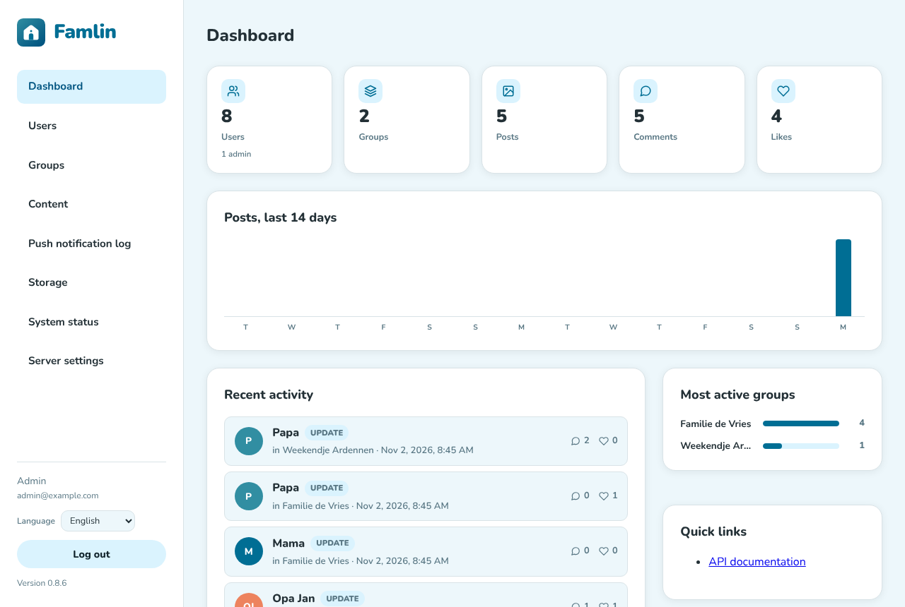
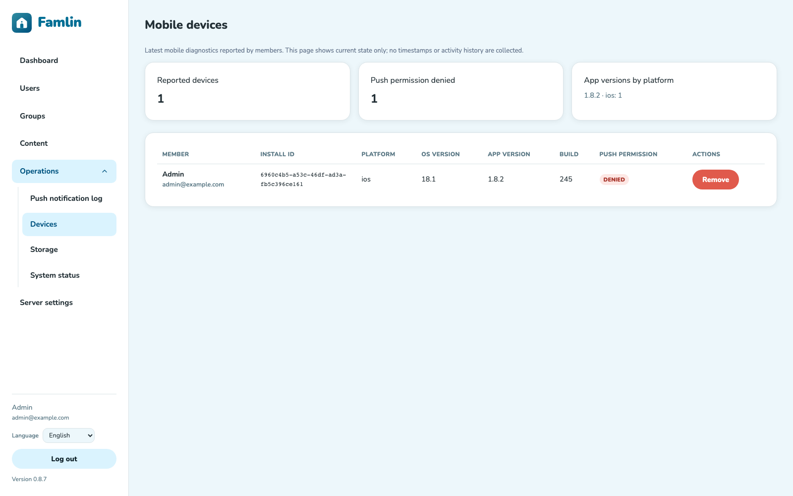
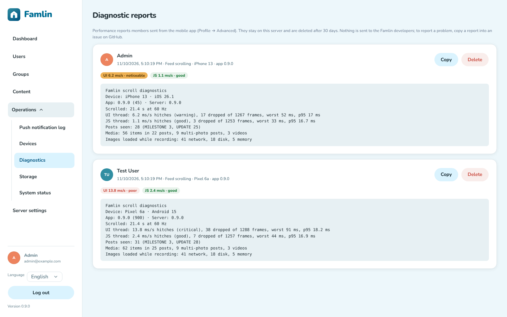
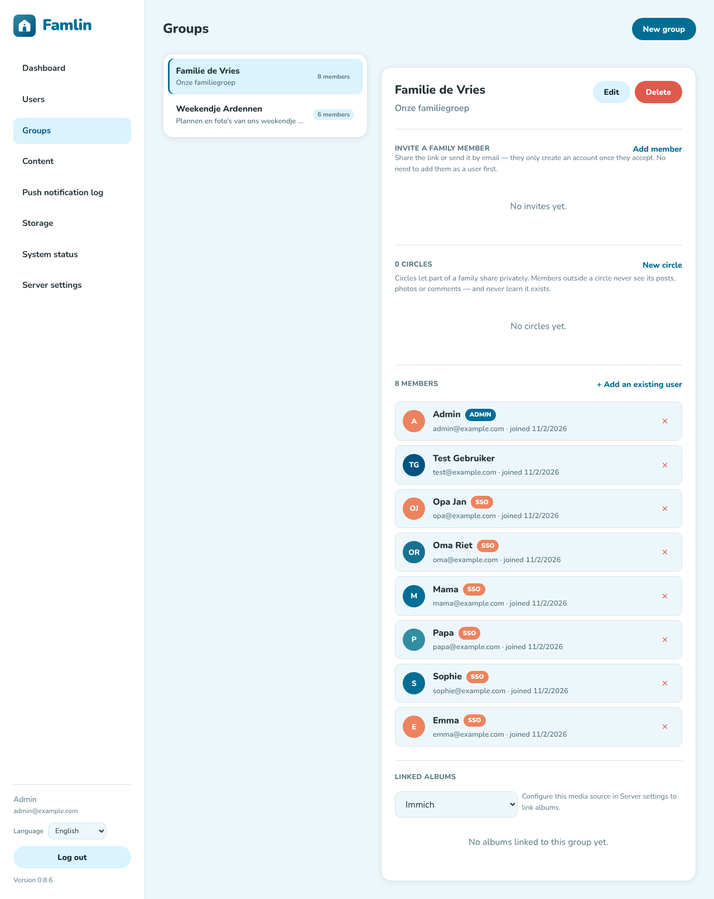
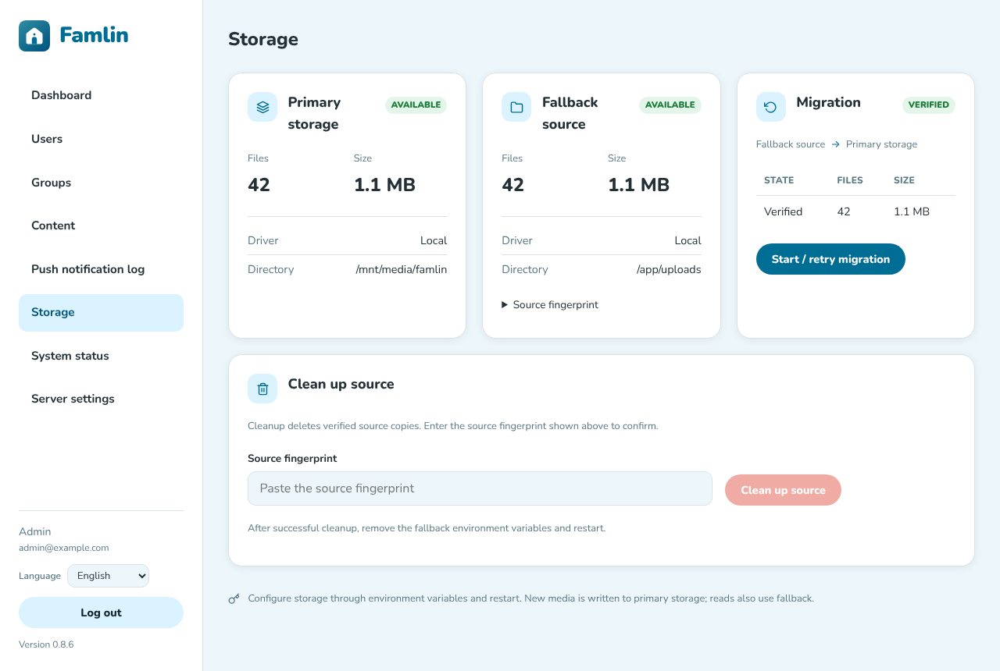
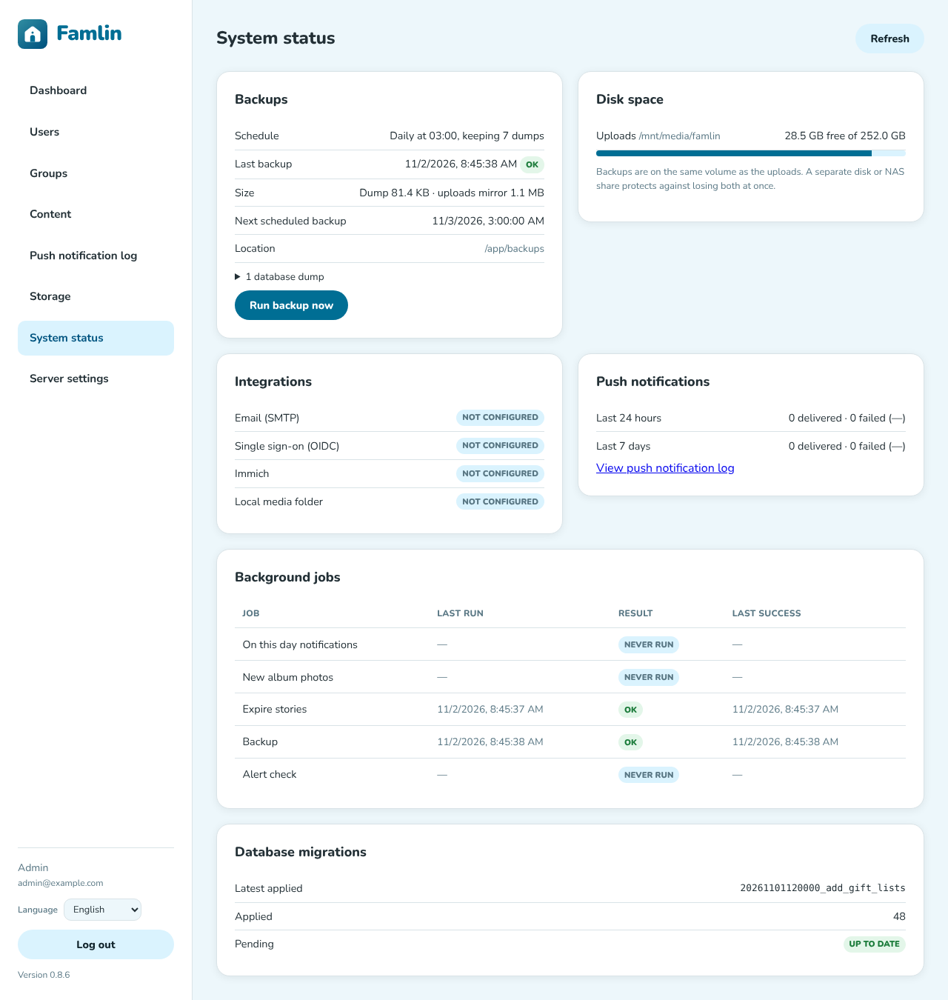
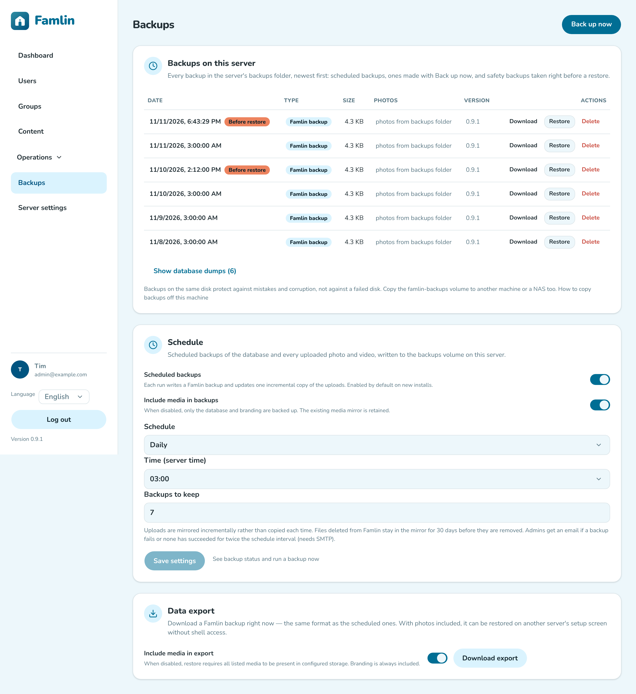
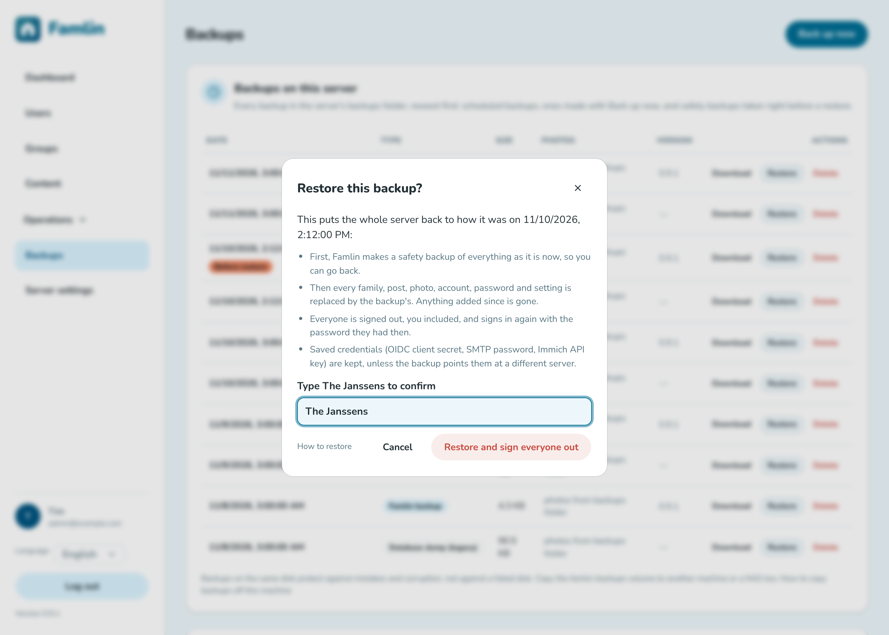

# Managing users, groups, and content

Day-to-day admin tasks all live under `/admin`, alongside the initial setup covered in [Admin configuration](./admin-configuration.md) and [Inviting family members](./inviting-family.md).

## Dashboard

`/admin` opens on the **Dashboard**: totals for users, groups, posts, comments and likes, recent activity, the most active groups, and a trend over time. When a newer Famlin version is available, a banner (shown on every admin page) links to its release notes. Quick links point to the API documentation.

## Users

The **Users** page lists every account, their group memberships, and whether they're an admin. Accounts are always ordered by ID (ascending), including when loading more rows or refreshing after an edit. Background refreshes keep the table and open management modals visible and preserve previously loaded pages.

Confirmations and messages throughout the admin panel use in-app modals. All modals close with **Esc** or a click outside the window, except while a save is in progress. Destructive confirmations focus **Cancel** by default; press **Confirm** to proceed.

- **Add a member** — click **Add member** to open the same modal used from the Groups page (see below). It defaults to **Invite** mode (pick a group, optional email, expiry); switch to **Create with password** to set up an account directly — name, email, password (8+ characters), an admin checkbox, and which groups to add them to — for family members without email/OIDC. Useful for an account that won't sign up itself via OIDC or an invite link.
- **Toggle admin access** — click the shield icon on a user's row. Admins can reach every page under `/admin`, so keep this limited to people you trust. You can't remove admin access from the last remaining admin — Famlin blocks that so you can't accidentally lock everyone out.
- **Reset a password** — click the key icon to open the password modal, enter a new password (8+ characters), and press **Save**. The input is masked, validation and server errors appear inside the modal, and duplicate submissions are blocked while saving. After success, share the password with the user directly. There's no self-service/email-based reset flow yet. Resetting a password immediately signs that account out everywhere else it was logged in.
- **Manage group membership** — click the people icon to open a modal listing every group with add/remove buttons. This is the same membership data as the Groups page, just scoped to one user.
- **Toggle notifications** — the bell and mail icons flip all push/email notification types for that user on or off in one click; per-event-type settings (new post vs. comment vs. like) are only editable by the user themselves, in the app.
- **Delete a user** — permanently removes the account, and everything they created with it: their posts, comments, likes, and favorites are deleted along with them (unlike removing someone from a group, below, which keeps their existing posts/comments visible). This can't be undone. You can't delete your own account this way, and you can't delete the last remaining admin.

Members can also delete their own account without asking you, from **Profile → Delete account** in the mobile or web app (they have to type `DELETE` to confirm). It's the same permanent removal as the admin action above, so their posts, photos, comments and chat messages go with it and can't be restored. The only account that can't do this is the last remaining admin — if that's you and you want out, make someone else an admin first.

## Mobile devices

The **Devices** page shows the latest mobile diagnostics each member has shared with this server: install ID, platform, OS version, app version/build and push permission. The summary counts devices by app version/platform and shows how many have denied push permission; the list is grouped by member details to help with support questions.

This is current state only. There are no timestamps, last-seen values or activity history, and the page receives no data from the web app. Removing a device clears its diagnostics row; its push token remains registered unless the member logs out or Expo reports the token as unregistered.

## Diagnostic reports

Members can measure how smoothly the feed scrolls on their phone and send the result to you (**Profile → Advanced → Report scrolling performance** in the mobile app; see [Report a slow feed](./notifications-and-profile.mdx#report-a-slow-feed-mobile)). The **Diagnostics** page (under **Operations**) lists those reports, newest first: who sent it and when, the phone and app version, a rating for the screen (UI) and app (JS) threads, and the full report text.

The ratings use Apple's hitch-time thresholds: under 5 ms of late frames per second of scrolling is *good*, 5 to 10 is *noticeable*, above 10 is *poor*.

Reports stay on your server: Famlin never forwards them, and they're deleted automatically after 30 days (the **Prune diagnostic reports** job on the System status page). If a report points at a problem in Famlin itself, use **Copy** and paste the text into an issue on [GitHub](https://github.com/TimVanOnckelen/famlin/issues) — that's the only way the developers see it. **Delete** removes a report straight away. Reports are not part of the admin export or a restore; a member's own reports are in their member export, and are deleted with their account.

## Groups

The **Groups** page is a two-pane view: pick a group on the left, manage it on the right.

The group form (**New group** or **Edit**) holds the name, description, allowed post types, and the chat and stories switches:

- **Create / edit / delete a group** — **New group** at the top, or **Edit**/**Delete** on the selected group. A group just has a name and description; deleting one removes its posts and comments along with it (unlike posts/comments, a deleted group can't be restored).
- **Choose which post types the group allows** — the group form's **Allowed post types** section has one checkbox per post type the server supports (plain updates, milestones, polls, events, trip journals, shared albums, [gift lists](./gift-lists.md), and any added later). Leave every box checked (the default) to allow all of them, including types added in a future update — you don't need to come back and re-check anything after an upgrade. Uncheck a type to hide it from that group's post composer; at least one type must stay checked. Existing posts of a type you later uncheck aren't affected — they stay visible, only creating new ones of that type is blocked.
- **Enable or disable group chat** — the group form has a **Chat** toggle (off by default). When enabled, members can send messages in a shared group chat, pin photos/videos to messages, and see which members have read the latest messages. Chat is not end-to-end encrypted. When a milestone post is created in a group with chat on, a system message is automatically posted in the chat to announce it. Members control their own push-notification preference for chat messages from their profile settings.
- **Enable or disable stories** — the group form has an **Enable stories** toggle, **on by default** (including for groups that existed before stories were added — an upgrade turns stories on everywhere, so switch it off for any group that shouldn't have them). Stories are photos members share for 24 hours, decorated with text, stickers and drawings in the mobile app; after 24 hours they're permanently deleted, photo included, unless the author kept the story as one of the group's **Highlights**. Viewers can react and send the author one private reply, and the author can see who viewed it. Turning the toggle off stops new stories and also hides the group's existing stories and Highlights (turning it back on shows the Highlights again). Stories are created in the mobile app only; the web app can view, react and reply. Members opt in to push notifications for new stories from their profile (off by default, at most one per person per group per day). In the mobile story viewer, drag the photo downward to dismiss it: the photo follows your finger and reveals the previous screen. A short drag returns quickly and can be interrupted by another swipe; a longer drag or quick downward flick closes the viewer. The photo lightbox uses the same gesture for photos and videos, including swipe-to-close for videos. Playback pauses during the gesture.
- **Add an existing user to the group** — pick them from the dropdown next to **Add member** in the detail pane (the same action as "manage group membership" on the Users page).
- **Add a new member to the group** — click **Add member** in the detail pane to open the same modal as on the Users page, preselected to this group; see [Inviting family members](./inviting-family.md) for the invite flow it defaults to.
- **Add existing users** — click **Add an existing user** to open a modal listing every account not already in the group. Each row has an **Add** button. Added users leave the available list, and the modal stays open so you can add several people before closing it.
- **Remove a member** — the ✕ icon on their row. Removing someone from a group does **not** delete their existing posts/comments in that group — those stay visible to the remaining members (a deliberate choice, not a bug). It **does** remove them from every circle in that group, immediately: a circle is a smaller audience *inside* the family, so it can't keep granting access to someone the family itself no longer includes. Circles in their other families are untouched.
- **Family Circles** — a **Circles** section in the detail pane, just under the member list. A circle is a smaller audience *inside* the group ("Grandparents", "Cousins", "Adults only"), so a family doesn't have to split into separate groups to share with part of it.
  - **Create a circle** with a name and optional description, then add members from the group's own member list — only people already in the group can be added, since a circle narrows the group rather than granting access to it.
  - **Create and manage circles**: **New circle** opens a modal for its name and description. The pencil button on a circle opens the same form to edit these fields without changing its members or posts. Expand a circle's member list to see the same member cards as the parent group. **Add to circle** opens a modal listing only group members who are not already in that circle; each can be added individually without closing the modal. Removing someone requires confirmation.
  - **Members choose the audience when posting**: the composer offers "Everyone" or any circle they belong to. A circle post is invisible to everyone else in the family — feed, search, photos, comments, notifications, and the photo file itself.
  - **Circles are private, including from you.** Members outside a circle can't see that it exists. And *you* can only read a circle's content if you're a member of it — circle posts don't appear on the Content page unless you're in the circle. This is deliberate: an admin flag shouldn't be a key to every private conversation in the family. The trade-off is that you can't moderate content in a circle you're not in; if you need to, add yourself to the circle — and note that **its members will see you there**, because anyone in a circle can open its member list from a post and see who joined and when. Circle access is something you can take, not something you have silently.
  - **Deleting a circle permanently deletes its posts and its [Family Wiki](./family-wiki.md) pages**, along with their comments, photos and reactions. There is no restore, and no option to move the content back to the whole family — silently widening an audience is exactly what circles exist to prevent. The confirmation tells you how many posts and wiki pages will be destroyed; if you're not in the circle, that count is all you'll be able to see of them.
  - **Members can leave a circle themselves** from the app. Leaving a circle never removes them from the family group — they just stop seeing that circle's content. Only an admin can add them back.
- **Linked albums**: at the bottom of the detail pane. Link albums from Immich or a local folder to the group, and choose per album whether new photos are announced. See [Media integrations](./admin-configuration.md#media-integrations).
- **Invites** — further down the same page (status, copy link, revoke); see [Inviting family members](./inviting-family.md) for that flow.

## Content moderation

The **Content** page gives admins cross-group visibility into posts and comments, without needing to be a member of every group.

- Switch between the **Posts**, **Comments** and **Stories** tabs, and narrow the list with the filter bar: a text search over the content, a group filter, and an author filter (combine them freely; **Clear filters** resets everything).
- The posts tab also shows each post's comment/like counts and marks milestone posts; the comments tab shows a snippet of the post each comment was left on.
- **Delete** (trash icon) removes a post or comment permanently — the same as a member's own delete. This can't be undone.
- **Edit** (pencil icon, posts only) changes a post's text — to fix a typo or take out something that shouldn't be there. The post shows as *edited*; it stays the author's post. Photos can't be changed from here; admins can edit a post's text and photos from the post's detail view in the web or mobile app, the same way authors edit their own. If the post was shared with several families, only that family's copy changes.
- The **Stories** tab lists live stories and Highlights (with a thumbnail, whether it's still live or kept as a Highlight, and its view/reaction counts); it has no text search, since stories are photos. Deleting a story removes it and its photo permanently. **Private replies to stories are never shown to admins** — they're between the viewer and the story's author only.
- **Resend push notification** (bell icon, posts only) re-delivers a post's push notification to the group — useful if a member's device was offline or missed it the first time. It only resends the push itself; it doesn't send another email or add a duplicate entry to anyone's in-app notification history.
- **Content in circles you're not in isn't listed here.** Family Circles are a real privacy boundary that applies to admins too, so posts and stories shared with a circle you don't belong to are excluded from every tab — see the Circles bullet under [Groups](#groups) above.
- **Cross-posted content is moderated per group.** When a member shares a post with several of their groups at once, each group gets its own independent copy. Deleting one group's copy from the Content page only removes that copy — it doesn't touch the copies in the post's other groups.

There's no bulk delete action.

## Push notification log

The **Push notification log** page lists every push-notification send attempt — both automatic (a new post, comment, reaction, ...) and manually resent from the Content page — newest first. Each row shows when it was sent, the notification type, which post it was for (if any), how many people were eligible, how many devices were actually reached, how many failed, and who triggered it ("System" for automatic sends, otherwise the admin who clicked resend).

## Storage

The **Storage** page shows where uploaded photos and videos are stored: the driver (local folder or S3 bucket), the folder or bucket, prefix, endpoint and region, how many files and bytes it holds, and whether it's reachable right now.

Storage itself is configured with environment variables, not on this page. While you're [moving media between local and S3](./storage.md#moving-an-existing-installation-between-local-and-s3) (or between two folders), the page also shows the old storage as **Fallback source**, the migration's progress, any conflicts and errors, and the **Clean up source** action.

## System status

The **System status** page gives you one place to check that the server is healthy:

- **Backups**: whether [scheduled backups](./maintenance.md#scheduled-backups) are on, the last backup's time, result and size, the next scheduled run, the stored database dumps, and a **Run backup now** button. It warns you when the backups folder isn't a mounted volume, because backups there wouldn't survive the container being recreated.
- **Disk space**: free space on the uploads volume and on the backups volume (shown once if they're the same disk). A volume counts as low below 1 GiB free or below 5% free.
- **Integrations**: whether SMTP, OIDC sign-in, Immich and the local media folder are reachable right now. Each check is the same connection test Server settings uses; ones you haven't set up show "Not configured".
- **Push notifications**: delivered and failed sends over the last 24 hours and 7 days. More than 20% failures over the last day is flagged; the [push notification log](#push-notification-log) has the details.
- **Background jobs**: when each scheduled job (On this day notifications, new album photos, story expiry, backups, the alert check) last ran, whether it succeeded, and its error if it didn't.
- **Database migrations**: the latest applied migration, and any that are pending or failed.

**Alerts.** When a backup fails, no backup has succeeded for more than twice the schedule interval, or a volume is low on space, a red banner appears at the top of every admin page. Every admin also gets an email about it, at most one per problem per day for as long as it lasts. Emails need SMTP (Server settings → Notifications); they're sent even if member email notifications are switched off. Backup alerts only apply while scheduled backups are on.

## Backups

The **Backups** page in the admin menu has everything backup-related in one place.

- **Backups on this server** lists every backup in the server's backups folder, newest first: date, size, where its photos are, and the Famlin version that made it. Backups marked **Before restore** are safety backups Famlin took automatically right before a restore. Until Famlin 1.0.0 every run also writes a database dump; those are hidden behind **Show database dumps** and can be restored too.
  - **Download** saves the file to your computer (keep a copy off the server).
  - **Delete** removes it from the backups folder for good. The shared copy of the photos stays.
  - **Restore** puts the whole server back to that backup — see below.
- **Back up now** (top right) starts a backup straight away, whatever the schedule.
- **Schedule**: turn scheduled backups on or off, choose daily or weekly, the hour, how many backups to keep, and whether photos are copied too. See [Scheduled backups](./maintenance.md#scheduled-backups).
- **Data export**: download a backup on demand, optionally with every photo inside (see [Data export](#data-export) below).

### Restoring a backup on a running server

**Restore** replaces *everything* on the server — every family, post, photo, account, password and setting — with the backup's. Only a signed-in admin can do it, not an API token.

1. Press **Restore** next to the backup. The dialog lists what will happen.
2. Type your family's name (as set under [Branding](./admin-configuration.md#branding); **Famlin** if you never set one) and press **Restore and sign everyone out**.
3. Famlin first makes a **safety backup** of the server as it is now. If that fails, nothing is restored.
4. While it restores, Famlin is unavailable for everyone (the apps show an error for a few moments). This takes seconds for a small family and a few minutes for a large one.
5. Afterwards **everyone is signed out**, you included, and signs in again with the password they had when the backup was made.

Saved credentials (OIDC client secret, SMTP password, Immich API key) are kept, because backups never contain them — unless the backup points that credential at a different server (another SMTP host, say); then enter it again. Changed your mind? Restore the **Before restore** backup the same way.

An older data export without passwords can't be restored here; restore it on a new server's setup screen instead (see [Restoring a backup](./maintenance.md#restoring-a-backup)).

## Data export

The **Backups** page has a **Data export** card with a **Download export** button. It downloads a zip containing:

- All posts, comments, reactions, and favorites, across every group — **including posts shared with circles you're not a member of**. This is the one place circle privacy doesn't apply, because a backup that silently left content out wouldn't be a usable backup. Treat the export file accordingly.
- All chat messages.
- Story **Highlights** (stories their authors kept) and their reactions. Live stories, who viewed them and private story replies are **not** included — a live story is deleted within 24 hours anyway, and replies are private between two people.
- The member list (names, emails, avatars, admin status), group membership, and circles.
- Every uploaded photo and video, including the original, unresized files — except the photos of live (not kept) stories.
- Your [branding](./admin-configuration.md#branding) — family name, color and logo.

**Include media in export** (on by default) decides whether photos and videos go into the zip. Switch it off for a small export of just the content, for example when your media lives in S3 and is backed up there: such an export can only be restored onto a server that already has the same media in its storage. See [Backups and exports with S3](./storage.md#backups-and-exports-with-s3).

It also includes every account's password (as a hash, never readable) and your server settings, so everyone signs in as before after a restore. It deliberately does **not** include the OIDC client secret, the SMTP password, the Immich API key, invite links, push tokens, device diagnostics, or API tokens — enter those secrets again after restoring. Keep the zip as private as the database itself.

It also includes circles and their members, poll votes, chat read positions, linked media albums and people mappings, and which photos belong to which circle — so it can be **restored onto a new, empty server** from that server's first-run setup screen. See [Restoring a backup](./maintenance.md#restoring-a-backup) for the steps and what you'll need to set up again afterwards.

The export itself is a manual, on-demand download, and can take a while to generate on a server with a lot of photos/videos. For automatic backups, turn on [scheduled backups](./maintenance.md#scheduled-backups) instead: they write the same zip without photos, plus one incremental copy of the uploads, rather than a full copy of every photo per backup.

### Members can export their own data

Every member — not just admins — can download a copy of their family's content from their own profile, under **Your data → Download my data** (web and mobile app). That export is scoped to what the member can already see in the app: every post in their groups, **including other members' posts**, with the comments, reactions, chat, and photos/videos that go with them, plus their own favorites and latest mobile device diagnostics. It never includes another group's content, posts in circles they're not a member of, other members' favorites or notification settings, or any of the server secrets listed above. Each member can request up to 5 exports per hour.
