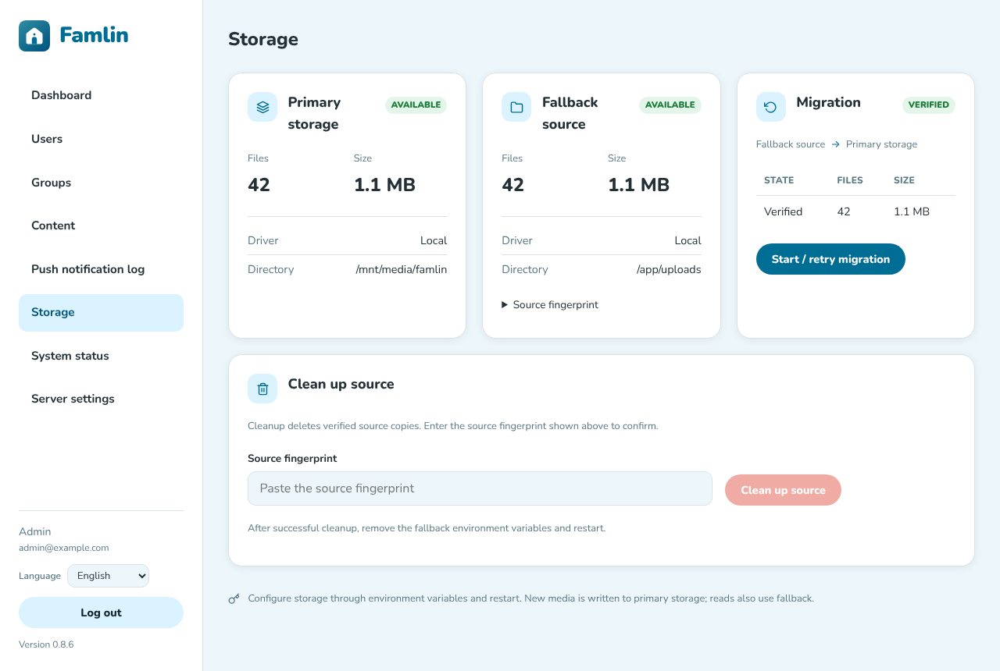

# Storage

This page explains where Famlin keeps its data and how to choose and set up where photos and videos are stored. You can use the default Docker volume, a folder on another disk or NAS, or an S3-compatible bucket. It also covers moving an existing installation from one to another.

If you're installing Famlin for the first time, the defaults from [Server setup](./server-setup) work as they are. Come back here when you want media on a different disk, on a NAS, or in object storage.

## What Famlin stores, and where

| What | Default location | Set by | Notes |
| --- | --- | --- | --- |
| **Database**: users, groups, posts, comments, reactions, settings | `famlin-db-data` volume (Postgres container) | `docker-compose.yml` | Small. Holds everything except media files. |
| **Media**: photos, videos and avatars members upload | `famlin-uploads` volume at `/app/uploads` | `STORAGE_DRIVER` (default `local`), `UPLOADS_DIR` | Usually the largest by far. Can live in S3 instead, see [below](#option-c-s3-or-an-s3-compatible-service). |
| **Branding logo** | `/app/uploads/branding/` | (always local) | Always stays on the local uploads volume, even with S3. |
| **Scheduled backups** | `famlin-backups` volume at `/app/backups` | `BACKUPS_DIR` | Database dumps plus a mirror of the media. See [Maintenance](./maintenance#scheduled-backups). |
| **Temporary files** while processing an upload | container's temp dir (`/tmp`) | (none) | Up to 200 MB per uploaded file, removed right after processing. |

For every uploaded photo, Famlin keeps three copies inside its media storage:

- a resized **display copy** (max 1920 px), which the apps show;
- the untouched **original** under `originals/`, which is never served but kept for exports and backups;
- a small **thumbnail** (400 px) for grids.

Videos are stored as uploaded, plus a poster image. Old HEIC photos get a browser-friendly copy under `derived/` the first time someone opens them. Plan for **media storage of about 1.5× the size of what your family uploads**.

:::info Not the same as "Media integrations"
**Immich** and **Local folders** under Server settings → Media are *sources* that members can pick photos from. Famlin only reads from them and never stores its own uploads there. See [Media integrations](./admin-configuration#media-integrations). This page is about where Famlin keeps the files that members upload *to Famlin*.
:::

## Choosing where media lives

| Option | Good for | Setup effort |
| --- | --- | --- |
| [A. Default Docker volume](#option-a-the-default-docker-volume) | Most installs, a single server or NAS with enough disk | None |
| [B. A folder on another disk or NAS share](#option-b-a-folder-on-another-disk-or-nas-share) | A small system disk and a bigger data disk, or a NAS share | One line in `docker-compose.yml` |
| [C. S3 or an S3-compatible service](#option-c-s3-or-an-s3-compatible-service) | A VPS with little disk, or media in MinIO, Garage, AWS S3, Backblaze B2, Cloudflare R2, Wasabi… | Bucket, key and a few `.env` lines |

The choice is invisible to members: photo links stay the same whichever option you pick, and every request is still checked against who's allowed to see that photo.

## Option A: the default Docker volume

Nothing to configure. `docker-compose.yml` mounts the named volume `famlin-uploads` at `/app/uploads`, and Famlin writes there.

To see where the volume lives on the host (for example to include it in an existing backup routine):

```bash
docker volume inspect famlin_famlin-uploads
```

The `famlin_` prefix is the Compose project name, which is usually the name of the folder holding `docker-compose.yml`. If you later start the stack from a differently named folder, Docker creates a *new, empty* volume and photos seem to disappear. See [Troubleshooting](#troubleshooting).

## Option B: a folder on another disk or NAS share

Replace the named volume with a bind mount to the folder you want. Change the `famlin-backend` service in `docker-compose.yml`:

```yaml title="docker-compose.yml"
  famlin-backend:
    # ...
    volumes:
      - /volume2/famlin/uploads:/app/uploads   # was: famlin-uploads:/app/uploads
      - famlin-backups:/app/backups
```

Then:

1. **Create the folder and give the container write access.** The container runs as the unprivileged `node` user (uid 1000):

   ```bash
   mkdir -p /volume2/famlin/uploads
   chown -R 1000:1000 /volume2/famlin/uploads
   ```

2. **Moving an existing install?** Stop the stack, copy the old volume's contents into the new folder with permissions intact, then start it again:

   ```bash
   docker compose -f docker-compose.yml down
   docker run --rm -v famlin_famlin-uploads:/from -v /volume2/famlin/uploads:/to alpine \
     sh -c 'cp -a /from/. /to/ && chown -R 1000:1000 /to'
   docker compose -f docker-compose.yml up -d
   ```

3. **Check it works.** `docker compose ps` should show `famlin-backend` as `healthy`. The health check fails when the uploads folder isn't writable. Then upload a test photo in the app.

Leave `UPLOADS_DIR` unset: changing the mount is enough. `UPLOADS_DIR` only matters if you mount the folder somewhere else than `/app/uploads` inside the container.

:::tip Network shares (NFS/SMB)
A share mounted on the host works the same way. Make sure uid 1000 can write to it (on SMB, mount it with `uid=1000,gid=1000`). Also make sure the share is mounted *before* Docker starts, or the container writes to the empty mount point underneath. Expect photos to load a bit slower than from a local disk.
:::

The same approach works for backups: see [Keep backups off the machine they protect](./maintenance#scheduled-backups).

## Option C: S3 or an S3-compatible service

With `STORAGE_DRIVER=s3`, Famlin writes media to a bucket instead of the uploads volume. Members' apps still load photos through Famlin, which checks each request, so **the bucket stays private**. Never make it public.

### 1. Create a bucket and an access key

Create a bucket (for example `famlin`) and an access key that may, for that bucket (or the prefix you'll use):

- check that the bucket exists (`s3:ListBucket` / HeadBucket);
- list, read, write and delete objects (`s3:GetObject`, `s3:PutObject`, `s3:DeleteObject`);
- do multipart uploads (`s3:AbortMultipartUpload`, `s3:ListMultipartUploadParts`).

An example AWS IAM policy for the bucket `famlin`:

```json
{
  "Version": "2012-10-17",
  "Statement": [
    {
      "Effect": "Allow",
      "Action": ["s3:ListBucket"],
      "Resource": "arn:aws:s3:::famlin"
    },
    {
      "Effect": "Allow",
      "Action": [
        "s3:GetObject",
        "s3:PutObject",
        "s3:DeleteObject",
        "s3:AbortMultipartUpload",
        "s3:ListMultipartUploadParts"
      ],
      "Resource": "arn:aws:s3:::famlin/*"
    }
  ]
}
```

Self-hosted services (MinIO, Garage, …) have their own policy format with the same permissions.

### 2. Configure `.env`

Add the settings to the `.env` file next to `docker-compose.yml`. The supplied `docker-compose.yml` already passes all of them to the backend.

For **AWS S3**:

```dotenv title=".env"
STORAGE_DRIVER=s3
S3_BUCKET=famlin
S3_REGION=eu-west-1
S3_ACCESS_KEY_ID=AKIA...
S3_SECRET_ACCESS_KEY=...
```

For **MinIO, Garage, or another self-hosted / S3-compatible service**:

```dotenv title=".env"
STORAGE_DRIVER=s3
S3_BUCKET=famlin
S3_ENDPOINT=https://s3.example.com
S3_REGION=us-east-1
S3_FORCE_PATH_STYLE=true
S3_ACCESS_KEY_ID=...
S3_SECRET_ACCESS_KEY=...
```

#### Provider examples

<details>
<summary><b>Hetzner Object Storage</b></summary>

1. In the [Hetzner Console](https://console.hetzner.com), open your project and go to **Object Storage** → **Create Bucket**. Pick a location (Falkenstein `fsn1`, Nuremberg `nbg1` or Helsinki `hel1`), a globally unique name, and keep the visibility **Private**.
2. Go to **Security** → **S3 credentials** → **Generate credentials**. Copy the access key and the secret key right away: the secret is shown only once.
3. In `.env`, use the location as region and in the endpoint:

   ```dotenv title=".env"
   STORAGE_DRIVER=s3
   S3_BUCKET=famlin-janssens
   S3_ENDPOINT=https://fsn1.your-objectstorage.com
   S3_REGION=fsn1
   S3_ACCESS_KEY_ID=...
   S3_SECRET_ACCESS_KEY=...
   ```

   For Nuremberg or Helsinki, replace `fsn1` in both lines with `nbg1` or `hel1`.

By default, Hetzner's S3 credentials give access to **every bucket in the project**. You can restrict individual keys with [bucket policies](https://docs.hetzner.com/storage/object-storage/faq/s3-credentials/#how-do-i-restrict-access-per-key), or put Famlin in its own Hetzner project to isolate its storage.

</details>

<details>
<summary><b>Hetzner Storage Box</b> (not S3)</summary>

A Storage Box speaks SMB/CIFS, SFTP and WebDAV, but not S3. Use it with [Option B](#option-b-a-folder-on-another-disk-or-nas-share): mount it on the host, then bind-mount that folder into the container. For example, in `/etc/fstab` (enable **Samba/CIFS** for the Storage Box in the Hetzner Console first):

```text title="/etc/fstab"
//u123456.your-storagebox.de/backup /mnt/storagebox cifs credentials=/etc/storagebox.cred,uid=1000,gid=1000,iocharset=utf8,_netdev 0 0
```

and in `docker-compose.yml`:

```yaml
    volumes:
      - /mnt/storagebox/famlin/uploads:/app/uploads
```

A Storage Box also makes a good off-site target for **backups** (mount it at `/app/backups` instead, see [Scheduled backups](./maintenance#scheduled-backups)).

</details>

<details>
<summary><b>MinIO</b> (self-hosted)</summary>

```dotenv title=".env"
STORAGE_DRIVER=s3
S3_BUCKET=famlin
S3_ENDPOINT=http://minio:9000
S3_REGION=us-east-1
S3_FORCE_PATH_STYLE=true
S3_ACCESS_KEY_ID=famlin
S3_SECRET_ACCESS_KEY=...
```

If MinIO runs in the same Compose project, use its service name in the endpoint, as above. Otherwise use its URL, preferably over `https://`.

</details>

<details>
<summary><b>Backblaze B2, Cloudflare R2, Wasabi</b></summary>

All three use the S3 settings with their own endpoint:

| Provider | `S3_ENDPOINT` | `S3_REGION` |
| --- | --- | --- |
| Backblaze B2 | `https://s3.<region>.backblazeb2.com`, e.g. `https://s3.eu-central-003.backblazeb2.com` | the region from the endpoint, e.g. `eu-central-003` |
| Cloudflare R2 | `https://<account-id>.r2.cloudflarestorage.com` | `auto` |
| Wasabi | `https://s3.<region>.wasabisys.com`, e.g. `https://s3.eu-central-1.wasabisys.com` | the region, e.g. `eu-central-1` |

Create an application key or API token with read/write access to the bucket in the provider's dashboard, and use it as `S3_ACCESS_KEY_ID` / `S3_SECRET_ACCESS_KEY`.

</details>

#### All settings

| Variable | Required | Meaning |
| --- | --- | --- |
| `STORAGE_DRIVER` | yes | `s3` (the default is `local`). |
| `S3_BUCKET` | yes | Bucket name. |
| `S3_REGION` | no | Defaults to `us-east-1`. Many self-hosted services accept any value. |
| `S3_ENDPOINT` | no | Leave empty for AWS. For anything else, the service's URL (`http://` or `https://`, without user/password or query string). |
| `S3_FORCE_PATH_STYLE` | no | `true` or `false` (default). Most self-hosted services (MinIO, Garage) need `true`. |
| `S3_PREFIX` | no | Store everything under this "folder" in the bucket, e.g. `famlin` or `family/media`. Each segment must start with a letter, digit, `_` or `-`; subsequent characters may also include `.`. Empty segments are not allowed. Useful to share a bucket. |
| `S3_ACCESS_KEY_ID` / `S3_SECRET_ACCESS_KEY` | no | Set both, or neither. With neither, the standard AWS credential chain is used (for example an IAM role on an EC2 instance). |
| `S3_SESSION_TOKEN` | no | Only for temporary credentials, together with the two above. |

### 3. Restart and check

```bash
docker compose -f docker-compose.yml up -d
```

- Invalid configuration, such as missing bucket names or incomplete credentials, stops startup with an error in `docker compose logs famlin-backend`. See [Troubleshooting](#troubleshooting). The S3 startup availability check has a five-second timeout. If primary initialization fails, Famlin logs an error and continues with the configured fallback if it initializes successfully. Fallback reads and writes remain active until restart, and media deletion, migration and cleanup are disabled until primary access is restored and the server is restarted. Without a usable fallback, startup fails.
- `docker compose ps` shows `famlin-backend` as `healthy` once Famlin can reach the database and write to the active storage (primary, or fallback after startup failover). With active S3 storage, the health check writes and deletes a tiny test object every 30 seconds.
- **Admin → Storage** shows the bucket, prefix, endpoint and region it uses, and whether the bucket is available.
- Upload a photo in the app and check that it appears in the bucket.

**This is for a new install, or one without photos yet.** If your server already has photos on the local volume, *don't* just switch the driver. Famlin would no longer find the existing photos. Follow [Moving an existing installation](#moving-an-existing-installation-between-local-and-s3) instead.

### Keep the uploads volume

Keep the `famlin-uploads` volume mounted, even with S3. Your branding logo always stays there, and `/app/uploads` is the fallback source when you migrate. Also make sure the container has some free temporary space (the container's `/tmp`): each upload, up to 200 MB, is processed there before it goes to the bucket.

:::note Tested providers
Famlin's S3 driver is tested against MinIO. Other services that implement the S3 API, such as AWS S3, Hetzner Object Storage, Garage, Backblaze B2, Cloudflare R2 and Wasabi, are expected to work, but aren't tested automatically. If you run into a provider-specific issue, please [open an issue](https://github.com/TimVanOnckelen/famlin/issues).
:::

## Moving an existing installation between local and S3

Famlin can move all media from one storage to the other **while it keeps running**. During the move:

- new uploads go to the new storage, which is called the **primary**;
- photos that aren't copied yet are read from the old storage, which is called the **fallback**;
- members don't notice anything.



### Step by step: local → S3

1. **Make a backup first.** Run a backup from **Admin → System status → Run backup now**, or see [Backups](./maintenance#backups).
2. **Create the bucket and key** as described in [Option C](#1-create-a-bucket-and-an-access-key).
3. **Add the new primary *and* the old storage as fallback** to `.env`:

   ```dotenv title=".env"
   # New primary: S3
   STORAGE_DRIVER=s3
   S3_BUCKET=famlin
   S3_ENDPOINT=https://s3.example.com
   S3_REGION=us-east-1
   S3_FORCE_PATH_STYLE=true
   S3_ACCESS_KEY_ID=...
   S3_SECRET_ACCESS_KEY=...

   # Old storage, read from until everything is copied
   STORAGE_FALLBACK_DRIVER=local
   STORAGE_FALLBACK_UPLOADS_DIR=/app/uploads
   ```

4. **Restart the backend:** `docker compose -f docker-compose.yml up -d`. If you run several backend containers, restart *all* of them with the same settings.
5. **Open Admin → Storage.** It shows the primary on the left and the fallback in the middle. Click **Start / retry migration**. The **Migration** card shows how many files and bytes are copied, verified, in conflict or failed. You can leave the page: the migration keeps running in the background and continues after a restart.
6. **Wait until the state is *Verified*.** If there are **conflicts** (a file with the same name but different content already exists in the destination) or **errors**, open the error list. Fix the cause, for example by removing a wrong file from the bucket yourself, then click **Start / retry migration** again. Famlin never overwrites a file that differs.
7. **Clean up the old storage (optional).** Once verified, the **Clean up source** card unlocks. Copy the fallback's **fingerprint** from the Fallback source card, paste it, and click **Clean up source**. Famlin checks each file once more and only then deletes the old copy. You can also skip this step and remove the old files yourself later.
8. **Remove the fallback settings** (`STORAGE_FALLBACK_*`) from `.env` and restart again. Famlin never edits `.env` itself.

### Step by step: S3 → local

The same steps, the other way around. The primary becomes `local` and the bucket becomes the fallback:

```dotenv title=".env"
STORAGE_DRIVER=local

STORAGE_FALLBACK_DRIVER=s3
STORAGE_FALLBACK_S3_BUCKET=famlin
STORAGE_FALLBACK_S3_ENDPOINT=https://s3.example.com
STORAGE_FALLBACK_S3_REGION=us-east-1
STORAGE_FALLBACK_S3_FORCE_PATH_STYLE=true
STORAGE_FALLBACK_S3_ACCESS_KEY_ID=...
STORAGE_FALLBACK_S3_SECRET_ACCESS_KEY=...
# optional: STORAGE_FALLBACK_S3_PREFIX, STORAGE_FALLBACK_S3_SESSION_TOKEN
```

Make sure the uploads volume has enough free space for the whole media library first.

### Good to know

- **Source and destination may not overlap.** Two local folders where one is inside the other, or two S3 locations in the same bucket where one prefix contains the other, are refused at startup.
- **Don't change the old storage by hand** while the migration or cleanup runs.
- **Rotating credentials is fine** during a migration: the fingerprint identifies a location by driver, bucket, prefix, endpoint and region, not by key. If you change one of those, an interrupted migration doesn't resume, and you start it again from the Storage page.
- **What's copied:** every media file, including old files from before Famlin tracked uploads. Branding, temporary files and Famlin's own internal files are skipped.
- **How it's verified:** each copy is read back from the destination and compared by SHA-256 checksum. S3 ETags aren't trusted for this.
- Errors and conflicts are kept in the Storage page's history. They're operational data, so they aren't part of data exports.

<details>
<summary>How the migration works under the hood</summary>

The worker lists the source, copies each object by streaming it, and reads the destination again to verify the SHA-256 checksum. An existing identical object in the destination is verified and counted. A different one is recorded as a conflict and never overwritten. PostgreSQL advisory locks coordinate the worker with uploads and deletes in the running app, so a file deleted during the migration doesn't come back.

When primary storage initializes successfully, reads fall back to the old storage only when a file is *missing* from the primary. An access or connection error during a read is reported as an error, never treated as "missing". Startup failover is separate: if primary initialization fails, the server logs the failure and uses an initialized fallback for reads and writes until restart. Migration and cleanup are blocked in that mode; restore primary access and restart before migrating files written to fallback.

An interrupted migration resumes after a restart only when both locations' fingerprints still match. Cleanup is a separate action: it's only possible after a complete verification, and it needs the fallback's fingerprint typed in as confirmation. Before deleting, each source file and its copy are checked again. Changed, conflicting or unverified files are left in place.

</details>

## Backups and exports with S3

- **S3 is not a backup.** A bucket protects against a failing disk, not against deleting something by accident or a provider problem. Keep an independent copy.
- **Scheduled backups** ([Maintenance](./maintenance#scheduled-backups)) copy media from wherever it lives, primary and fallback, into `/app/backups/uploads/`. With a large library in S3 that means a full local copy. Under **Server settings → Backups**, you can switch off **Include media in backups** if you back up the bucket in another way (for example with bucket versioning or replication). The database dump and the branding logo are always backed up.
- **Data export** (Server settings → General) has the same **Include media** switch. An export without media is small, but it can only be restored onto a server that can already reach the same media, for example the same bucket. When restoring, Famlin checks that every file the export refers to is present and the right size before it writes anything. See [Restoring from a data export](./maintenance#restoring-from-a-data-export).

## Disk space

- **System status** in the admin UI warns when the uploads or backups volume drops below 1 GiB or 5% free. With S3, the bucket's own space isn't shown there. Keep an eye on it with your provider.
- With a local driver, the uploads volume needs about 1.5× your library (original plus display copy and thumbnail). Scheduled backups with media need roughly the same again on the backups volume.
- With S3, the local uploads volume only needs space for the branding logo, and `/tmp` needs space for uploads being processed.

## Troubleshooting

**The backend doesn't start, and the log says one of these:**

| Message | Fix |
| --- | --- |
| `S3_BUCKET is required` (or `STORAGE_FALLBACK_S3_BUCKET is required`) | Set the bucket name. |
| `S3 credentials must be configured together` | Set both the access key ID *and* the secret, or neither. A session token needs both. |
| `Invalid S3 endpoint` | Use a full `http://` or `https://` URL, without user/password, `?query` or `#hash`. |
| `S3_FORCE_PATH_STYLE must be true or false` | Use exactly `true` or `false`. |
| `Invalid S3 prefix` | Separate non-empty segments with `/`. Start each segment with a letter, digit, `_` or `-`; use only letters, digits, `.`, `_` and `-` after that. For example, use `family/media`, not `.media` or `family//media`. |
| `Unsupported storage driver` | `STORAGE_DRIVER` / `STORAGE_FALLBACK_DRIVER` must be `local` or `s3`. |
| `Fallback storage directory must already exist` | The `STORAGE_FALLBACK_UPLOADS_DIR` folder doesn't exist in the container. Check the volume mount. |
| `Storage directories overlap` / `Storage prefixes overlap` | Primary and fallback point to (part of) the same place. Use a different folder or prefix. |

**`famlin-backend` shows as `unhealthy`.** The health check fails when the database is unreachable or Famlin can't write to its active storage (primary, or fallback after startup failover). `docker compose logs famlin-backend` says which one (`media storage not writable`). Check folder permissions (uid 1000) for local storage, and the key's permissions and the endpoint for S3.

**Permission denied on a bind-mounted folder.** Run `chown -R 1000:1000` on the host folder, or on SMB mount it with `uid=1000,gid=1000`.

**Photos disappeared after a redeploy.** The `famlin-uploads` volume isn't being reused, usually because the stack was started from a differently named folder, which gives a different Compose project name. See [Troubleshooting in Maintenance](./maintenance#troubleshooting).

**Photos disappeared after switching to S3.** The existing photos are still on the local volume. Add the old storage as fallback and migrate, as described in [Moving an existing installation](#moving-an-existing-installation-between-local-and-s3).
